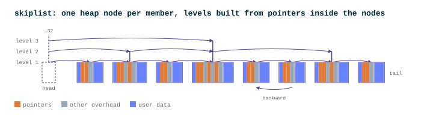
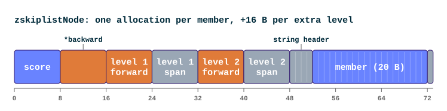
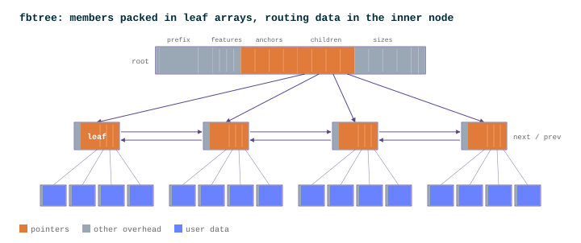
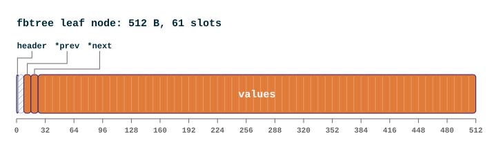
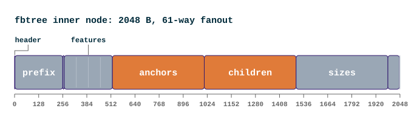
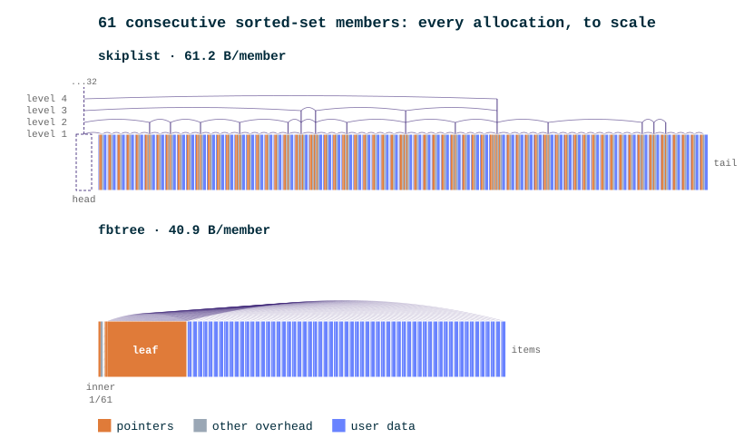
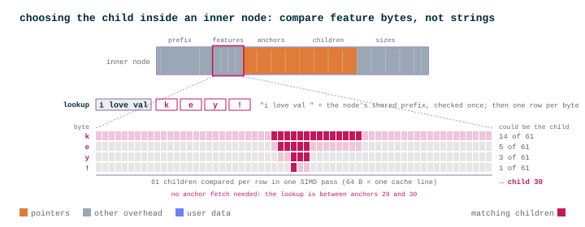

+++
title = "From Skiplists to B+ Trees: Making Valkey Sorted Sets More Memory Efficient"
date = 2026-11-11
description = "How Valkey 9.2 replaces the skiplist used by large sorted sets with a cache-friendly B+ tree, reducing memory overhead while improving several ordered-set operations." 
authors =  ["rainvalentine","dragosandriciuc"]
[taxonomies]
blog_type = ["Technical Deep Dive"]
+++

A [sorted set](https://valkey.io/topics/sorted-sets/) can spend more memory describing how its elements are ordered than storing the elements themselves.

In Valkey 9.2 that changes: the skiplist is replaced by a high-fanout B+ tree variant called **fbtree**.

fbtree combines the high fanout and contiguous storage of a conventional B+ tree with several optimizations designed for Valkey's workload and memory allocator, including feature-based lookups, SIMD searches, linked leaves, and fast paths for sequential inserts and pops.
In a 5-million-member test, it reduced per-member memory overhead by 36–43%, saving up to 109 MB.

Let's take a look at why this change happened and how it works.
The benchmarks below show the measured memory savings and command-performance changes in Valkey 9.2.

## Why replace the skiplist?

Large sorted sets that exceed the [listpack threshold](https://valkey.io/blog/secret-life-of-data/) are backed by a skiplist paired with a hashtable (smaller sorted sets use a compact listpack representation that stores elements sequentially in contiguous memory).
The hashtable gives O(1) lookups by member, while the skiplist gives O(log n) ordered lookups by rank or score.
That pairing has worked well for years, but the skiplist carries a hidden cost that is often overlooked.
It stores exactly one element per node, scattered across memory as separate allocations connected by pointers.

### Memory overhead

Valkey's skiplist pays for this in raw memory.
Every node carries a backward pointer (8B), plus an average of 1.33 levels of forward pointers and span values, since skiplists are probabilistic (each node has a 25% chance of gaining another level).
Each level costs 8B for the pointer plus 8B for the span value, giving around 29B of pointer and span overhead per node.
Add the 8B score, and the total reaches roughly 37B per node before accounting for the member string.

### Cache misses and dependent fetches

Modern CPUs use a hierarchy of hardware caches (L1, L2, and L3) to keep frequently accessed data close to the processor.
These caches are much smaller and faster than main memory (RAM), so when the CPU cannot find the data it needs in its cache, it must fetch it from a slower level of the memory hierarchy.
As a rough illustration, an L1 cache hit can take about 1 ns, while a DRAM access can take around 100 ns.
A dependent memory access can leave the core waiting; actual latency and how much work can be hidden vary by system and workload [^1].

Each node in the skiplist is a separate allocation, potentially scattered wherever the heap happened to place it, so following the structure can require repeatedly fetching data from unrelated memory locations.
Because each step can determine where the next step goes, these fetches are dependent, resulting in more round trips through the memory hierarchy.
A 2025 study of concurrent in-memory indexes found that, on its tested workloads, traditional skiplists experienced roughly 2.4–4.8× more cache misses than a comparable B-tree, with 2–8× lower throughput [^2] (testing different data structure implementations, not Valkey).

## What replaced it: fbtree

A B+ tree keeps entries sorted in fixed-size nodes: leaf nodes hold the entries, or pointers to them, and inner nodes hold just enough routing data to pick which child to descend into.
Packing many entries into each node addresses both problems above: far less per-member pointer overhead, and far fewer dependent fetches per lookup.

### Memory layout

fbtree, short for Feature B+ Tree, uses a 61-way fanout: each node can hold up to 61 entries or child pointers.
Leaf and inner nodes are sized to fit jemalloc allocation classes without wasting space on 64-bit builds; on supported 32-bit builds, `innerNode` is rounded up to the 1280-byte class.

A 512-byte leaf can hold up to 61 values, grouping up to 61 value pointers under one leaf allocation instead of giving every member its own node.
Instead of storing the score and member separately, fbtree stores them together as a single packed value: the normalized 8-byte score followed by the member bytes.
This keeps the data needed for comparisons together and removes another level of pointer indirection.

**Note:** This figure accounts only for the skiplist and fbtree data structures; it excludes the hashtable and all other server memory.
The benchmark numbers later in this post are heap-profiled per-member overhead at 5 million members, including the hashtable and all other server memory.
See [Benchmarks](#benchmarks) for the measured reduction from PR 4359. [^3]

### Fewer memory fetches

The skiplist's 25%-per-level rule gives it an effective branching factor of about 4, while fbtree's fanout is 61.
Both structures retain O(log n) search complexity, but the B+ tree has substantially fewer levels to traverse and therefore fewer opportunities for expensive memory fetches.

A modern CPU can also fetch several adjacent cache lines efficiently when the data is laid out contiguously, thanks in part to the way memory is accessed and to hardware prefetching [^1].
Therefore a B+ tree node that spans a few cache lines can be read efficiently as the CPU scans its contents.

### Optimizations

On top of that structure, fbtree adds optimizations aimed at specific operations.

In a B+ tree keyed by variable-length strings, such as sorted set members, picking a child means comparing the lookup against each child’s anchor, the largest member in that child, and reading those strings costs memory fetches.
fbtree's inner nodes store each anchor along with a small four-byte "feature."
Because the anchors often share a common prefix, fbtree stores that shared prefix separately and uses the four feature bytes to distinguish the children.
The implementation can then compare those features in parallel using SIMD, often identifying the correct child before fetching the child node itself.
If the features uniquely identify a child, the search can descend immediately; otherwise, they still narrow the range that needs a full binary search.

Range commands such as `ZRANGE` walk the set in order.
fbtree links its leaf nodes in a doubly-linked list, so a scan can move from leaf to leaf without climbing back up the tree.
The skiplist requests an item, waits to receive it, and only knows the next item to fetch when it's received the first.
The B+ tree can work on up to 61 items in parallel, and while it works on those it can fetch the next leaf node with the next 61 items.

Commands such as `ZPOPMIN` work at the ends of the set.
fbtree caches its leftmost and rightmost leaves, so finding them is O(1), as in a skiplist, instead of O(log n).
This keeps pop and append operations at parity rather than regressing.

Range deletions remove a contiguous run of members, and fbtree handles them without rebuilding the surrounding structure.

## What actually changed for you

Functionally, nothing changes.

The change is internal: sorted set commands and their behavior remain unchanged.
The one visible difference is that `OBJECT ENCODING` returns `btree` instead of `skiplist` for a large sorted set.
If you have monitoring, tests, or tooling that checks for the literal string `skiplist`, that's one place to update.
Small sorted sets under the listpack threshold are unaffected either way, since they never used the skiplist encoding to begin with.

## Benchmarks

### Memory efficiency

The numbers below compare only the ordered index: skiplist versus fbtree, with the hashtable and member embedding unchanged.

Inserting 5 million 20-byte members sequentially reduced per-member memory overhead, excluding the member data itself, from 50.3B to 28.5B, a **43% reduction**.
The same 5 million members inserted in random order reduced per-member overhead from 50.3B to 32.0B, a **36% reduction**.

The smaller reduction comes from random insertion leaving more partially filled nodes than sequential insertion.

For the 5-million-member set in this test, that is roughly 109 MB saved with sequential inserts and 92 MB with random inserts.
The savings are per member, not per byte stored, so the relative reduction in total memory is largest for sets with many small members and shrinks as member size grows.

### Command performance

The benchmarks below were measured on [PR #4206](https://github.com/valkey-io/valkey/pull/4206)’s `oi/pr3-fbtree-v2` branch and were not rerun for the merged commit.
They were run on a Graviton3 c7g.metal system with 64 cores, nine I/O threads, a pipeline depth of 10, and a 3-million-member sorted set.
Each test was repeated five times; the reported confidence intervals were ≤2% for all commands except `ZRANDMEMBER`.

The same underlying design changes also improve throughput for several sorted set operations:

**Note:** `ZSCORE` and `ZRANDMEMBER` barely move because they use the companion hashtable rather than the ordered index.

| Command | Workload | Throughput improvement |
|---|---|---:|
| `ZADD` | Score update (all hits) | +105% |
| `ZREM` | 50/50 random add/remove | +76% |
| `ZCOUNT` | Score-range count | +27% |
| `ZRANK` | Point rank lookup | +19% |
| `ZRANGE` | 100-element rank scan | +6% |
| `ZRANDMEMBER` | 100 random samples | +2% |
| `ZSCORE` | Point score lookup | +2% |
| `ZRANGEBYSCORE` | 100-element score scan | +1% |
| `ZPOPMIN` | Pop min + append new member | ~0% |

The pattern makes sense once you look at what each command actually does: `ZADD` and `ZREM` reposition elements in the tree, so they benefit most directly from fbtree's shallower structure and fewer pointer updates.
Range operations see smaller gains because once the index traversal becomes cheap, producing and returning the requested elements becomes a larger part of the total cost.

## Test Valkey 9.2 before GA

The important takeaway: **the commands didn't change**, but in our tests large sorted sets carried 36–43% less per-member overhead, and `ZADD` and `ZREM` throughput rose 105% and 76%.

The goal wasn't simply to make the data structure faster in isolation: the implementation was repeatedly benchmarked against the existing skiplist through the full Valkey server, with optimizations added until fbtree matched or exceeded the skiplist across the tested sorted set commands.

Valkey 9.2 is currently in release-candidate testing.
Before GA, try the [9.2 release candidate](https://valkey.io/download/9.2/) with your real workload, especially if large sorted sets or commands such as `ZADD`, `ZREM`, `ZRANK`, or `ZCOUNT` are important to you.
Your testing and feedback can help surface issues before the final release, so [open an issue](https://github.com/valkey-io/valkey/issues) with anything you find.

## References

[^1]: [What Every Programmer Should Know About Memory](https://cgvr.cs.uni-bremen.de/teaching/mpar_literatur/What%20Every%20Programmer%20Should%20Know%20About%20Memory%20-%20Ulrich%20Drepper,%202007.pdf)
[^2]: [Bridging Cache-Friendliness and Concurrency: A Locality-Optimized In-Memory B-Skiplist](https://arxiv.org/abs/2507.21492)
[^3]: [PR #4359](https://github.com/valkey-io/valkey/pull/4359)
