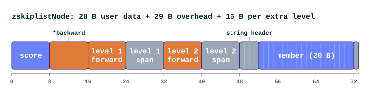
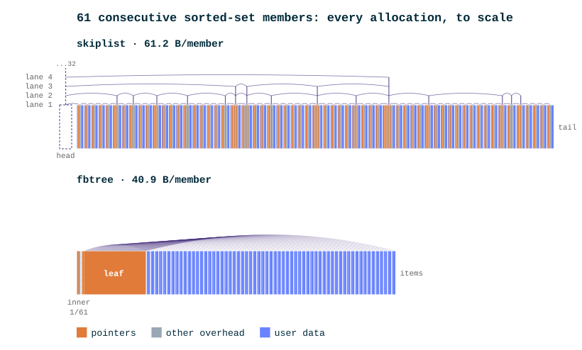
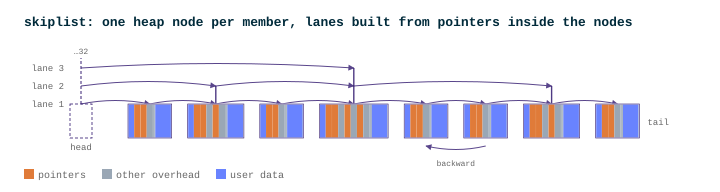
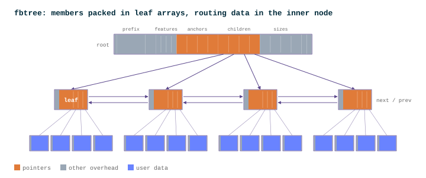
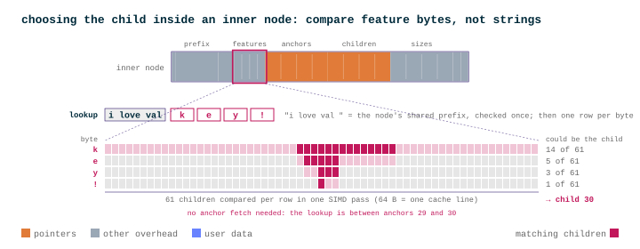
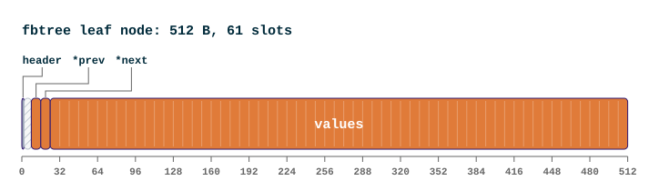
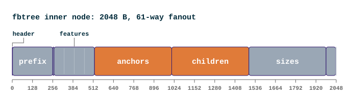

+++
title = "From Skiplists to B+ Trees: Making Valkey Sorted Sets More Memory Efficient"
date = 2026-10-30

description = "How Valkey 9.2 replaces the skiplist used by large sorted sets with a cache-friendly B+ tree, reducing memory overhead while improving several ordered-set operations." 
authors =  ["dragosandriciuc","rainvalentine"]
[taxonomies]
blog_type = ["Technical Deep Dive"]
+++

A [sorted set](https://valkey.io/topics/sorted-sets/) can spend more memory describing how its elements are ordered than storing the elements themselves.

In Valkey 9.2 that changes: the skiplist is replaced by a high-fanout B+ tree variant called **fbtree**.

fbtree combines the high fanout and contiguous storage of a conventional B+ tree with several optimizations designed for Valkey's workload and memory allocator, including feature-based lookups, SIMD searches, linked leaves, and fast paths for sequential inserts and pops.

Let's take a look at why this change happened, how it works, and why it's important for memory optimization moving forward.
A benchmarking example is also provided, showing the savings you can expect in Valkey 9.2.

## Why replace the skiplist?

Large sorted sets that exceed the [listpack threshold](https://valkey.io/blog/secret-life-of-data/) are backed by a skiplist paired with a hashtable (smaller sorted sets use a compact listpack representation that stores elements sequentially in contiguous memory).
The hashtable gives O(1) lookups by member, while the skiplist gives O(log n) ordered lookups by rank or score.
That pairing has worked well for years, but the skiplist carries a hidden cost that is often overlooked.
It stores exactly one element per node, scattered across memory as separate allocations connected by pointers.

That's not a Valkey-specific problem.
Modern CPUs use a hierarchy of hardware caches (L1, L2, and L3) to keep frequently accessed data close to the processor.
These caches are much smaller and faster than main memory (RAM), so when the CPU cannot find the data it needs in its cache, it must fetch it from a slower level of the memory hierarchy.
A 2025 study comparing fully concurrent in-memory index implementations found that, on its tested workloads, traditional skiplists experienced roughly 2.4–4.8× more cache misses than a comparable B-tree, with 2–8× lower throughput [^1].

**Note:** These figures come from the study's benchmark environment and should not be interpreted as measurements of Valkey's skiplist.

The mechanical reason is straightforward: a modern CPU can fetch several adjacent cache lines efficiently when the data is laid out contiguously, thanks in part to the way memory is accessed and to hardware prefetching [^5].
However, the bigger advantage is that a B+ tree requires fewer dependent memory fetches to reach the target data.

A B+ tree node that spans a few cache lines can therefore be read efficiently as the CPU scans its contents, while the tree's high fanout means fewer levels need to be traversed in the first place.

A skiplist is not designed like this.
Each node is a separate allocation, potentially scattered wherever the heap happened to place it, so following the structure can require repeatedly fetching data from unrelated memory locations.
Because each step can determine where the next step goes, these fetches are dependent, resulting in more round trips through the memory hierarchy.

**Note:** This comparison uses a different accounting convention than the benchmark numbers shown later in this post. See [Benchmarks](#benchmarks) for the measured reduction from PR 4359. [^4]

Valkey's skiplist pays for this in raw memory too.
Every node carries a backward pointer (8B), plus an average of 1.33 levels of forward pointers and span values, since skiplists are probabilistic.
Each level costs 8B for the pointer plus 8B for the span value, giving around 29B of pointer and span overhead per node.
Add the 8B score, and the total reaches roughly 37B per node before accounting for the member string [^2].

There's a cleaner way to think about that 25%-per-level rule: it gives the skiplist an effective branching factor of about 4.
A B+ tree with a fanout of 61 (each node can hold up to 61 entries or child pointers) searches a much larger portion of the dataset at each level.
Both structures retain O(log n) search complexity, but the B+ tree has substantially fewer levels to traverse and therefore fewer opportunities for expensive memory fetches.

In previous releases we [replaced `dict` with the new `hashtable` data structure](https://valkey.io/blog/new-hash-table/) and embedded the member in the hashtable entry.
The B+ tree change builds on these earlier improvements, further reducing the memory overhead of the ordered index rather than replacing those savings [^3].

## What replaced it: fbtree

fbtree, short for FB+ Tree or Feature B+ Tree, has inner nodes that store the first member of each child, called its anchor, along with a small four-byte “feature.”

Because the anchors often share a common prefix, fbtree stores that shared prefix separately and uses the four feature bytes to distinguish the children.
The implementation can then compare those features in parallel using SIMD, often identifying the correct child before fetching the child node itself.
If the features uniquely identify a child, the search can descend immediately; otherwise, they still narrow the range that needs a full binary search.

Structurally, the tree uses a 61-way fanout, with leaf and inner nodes sized to fit jemalloc allocation classes without wasting space on 64-bit builds; on supported 32-bit builds, `innerNode` is rounded up to the 1280-byte class.

A 512-byte leaf can hold up to 61 values, grouping up to 61 value pointers under one leaf allocation instead of giving every member its own node.
Instead of storing the score and member separately, fbtree stores them together as a single packed value: the normalized 8-byte score followed by the member bytes.
This keeps the data needed for comparisons together and removes another level of pointer indirection.
Leaf nodes (which hold the actual scored elements) are linked together in a doubly-linked list, so range operations like `ZRANGE` can walk forward without climbing back up the tree at every step.
Several targeted optimizations round it out. For example, fbtree caches its leftmost and rightmost leaves, allowing them to be found in O(1) as they are in a skiplist instead of O(log n). This means that pop and append operations such as `ZPOPMIN` are at parity rather than regressing.
fbtree also provides an efficient way to delete a contiguous range of elements without rebuilding the surrounding structure.

The payoff is this: When performing a lookup, both data structures have to perform a linear sequence of memory fetches and round trips one after the other, but fbtree requires far fewer than skiplist. Part of this is the reduced depth from having a higher fanout, but the rest is because of carefully designed metadata hints in each B+ tree node which usually provide enough information that the lookup knows exactly which path to take without having to fetch additional memory and wait.

Scanning a range is faster too. The skiplist requests an item, waits to receive it, and only knows the next item to fetch when it's received the first. The B+ tree can work on up to 61 items in parallel, and while it's happily working on those it can fetch the next leaf node which provides it the next list of 61 items.

It's true that the B+ structs are larger, larger in fact than a cache line (the memory system always deals in cache line size chunks). One might think that this would require multiple fetches, but in practice it is basically no slower than fetching a single cache line. This is because all can be fetched in parallel, and DRAM hardware usually makes adjacent cache lines very fast to fetch as well [^5].

## What actually changed for you

**Functionally, nothing changes.**

The change is internal: `ZSET` commands and their behavior remain unchanged.
The one visible difference is that `OBJECT ENCODING` returns `btree` instead of `skiplist` for a large sorted set.
If you have monitoring, tests, or tooling that checks for the literal string `skiplist`, that's one place to update.
Small sorted sets under the listpack threshold are unaffected either way, since they never used the skiplist encoding to begin with.

## Benchmarks

### Memory efficiency

fbtree's contribution is best isolated from the earlier improvements covered above: the `dict`-to-`hashtable` transition and embedding the member string in the node.
The skiplist baseline below already includes both of those changes, so what's measured here is specifically the effect of replacing the skiplist itself.

Inserting 5 million 20-byte members sequentially reduced per-member memory overhead, excluding the member data itself, from 50.3B to 28.5B, a **43% reduction**.
The same 5 million members inserted in random order reduced per-member overhead from 50.3B to 32.0B, a **36% reduction**.

The smaller reduction comes from random insertion leaving more partially filled nodes than sequential insertion.

### Command performance

The benchmarks below were measured on PR `#4206`’s `oi/pr3-fbtree-v2` branch and were not rerun for the merged commit.
They were run on a Graviton3 c7g.metal system with 64 cores, nine I/O threads, a pipeline depth of 10, and a 3-million-member sorted set.
Each test was repeated five times; the reported confidence intervals were ≤2% for all commands except `ZRANDMEMBER`.

The same underlying design changes also improve throughput for several sorted set operations:

**Note:** `ZSCORE` and `ZRANDMEMBER` barely move because they use the companion hashtable rather than the ordered index.

| Command | Workload | Throughput improvement |
|---|---|---:|
| `ZADD` | Score update (all hits) | +105% |
| `ZREM` | 50/50 random add/remove | +76% |
| `ZCOUNT` | Score-range count | +27% |
| `ZRANK` | Point rank lookup | +19% |
| `ZRANGE` | 100-element rank scan | +6% |
| `ZRANDMEMBER` | 100 random samples | +2% |
| `ZSCORE` | Point score lookup | +2% |
| `ZRANGEBYSCORE` | 100-element score scan | +1% |
| `ZPOPMIN` | Pop min + append new member | ~0% |

The pattern makes sense once you look at what each command actually does: `ZADD` and `ZREM` reposition elements in the tree, so they benefit most directly from fbtree's shallower structure and fewer pointer updates.
Range operations see smaller gains because once the index traversal becomes cheap, producing and returning the requested elements becomes a larger part of the total cost.

## Known limitations

One gap worth knowing about if you run delete-heavy sorted set workloads: fbtree doesn't yet merge or rebalance nodes on delete.
If your workload adds and removes elements at similar rates over a long period, leaf nodes can end up sparse, which is technically correct, but no longer packed as tightly as a fresh insert would be.

Background compaction is planned as a follow-up. Until it is available, deletes do not merge or rebalance fbtree nodes, so a churned sorted set can retain mostly empty leaves and use more memory than a skiplist with the same live members. For example, one exercised workload with 2,000 surviving members used 1,305,368 bytes for fbtree versus 175,760 bytes for a skiplist; this workload-specific result is not a general ratio, but it shows why capacity planning should account for sparse leaves. For delete-heavy workloads, monitor `MEMORY USAGE` over time rather than assuming the insertion benchmarks above hold indefinitely.

## Test Valkey 9.2 before GA

The important takeaway is simple: **the commands didn't change**, but the cost of keeping them fast did.

The goal wasn't simply to make the data structure faster in isolation: the implementation was repeatedly benchmarked against the existing skiplist through the full Valkey server, with optimizations added until fbtree matched or exceeded the skiplist across the tested sorted set commands.

Valkey 9.2 is currently in release-candidate testing. Before GA, try the release candidate with your real workload—especially if large sorted sets or commands such as `ZADD`, `ZREM`, `ZRANK`, or `ZCOUNT` are important to you. Your testing and feedback can help surface issues before the final release.

## References

[^1]: [Bridging Cache-Friendliness and Concurrency: A Locality-Optimized In-Memory B-Skiplist](https://arxiv.org/abs/2507.21492)
[^2]: [Issue #3166](https://github.com/valkey-io/valkey/issues/3166)
[^3]: [A new hash table: Technical Deep Dive](https://valkey.io/blog/new-hash-table/)
[^4]: [PR #4359](https://github.com/valkey-io/valkey/pull/4359)
[^5]: [What Every Programmer Should Know About Memory](https://cgvr.cs.uni-bremen.de/teaching/mpar_literatur/What%20Every%20Programmer%20Should%20Know%20About%20Memory%20-%20Ulrich%20Drepper,%202007.pdf)
