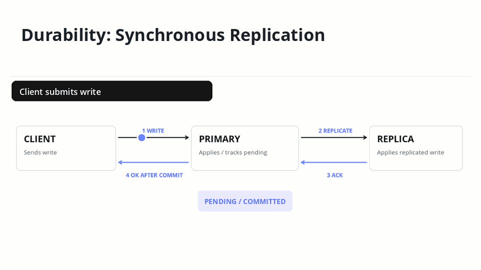
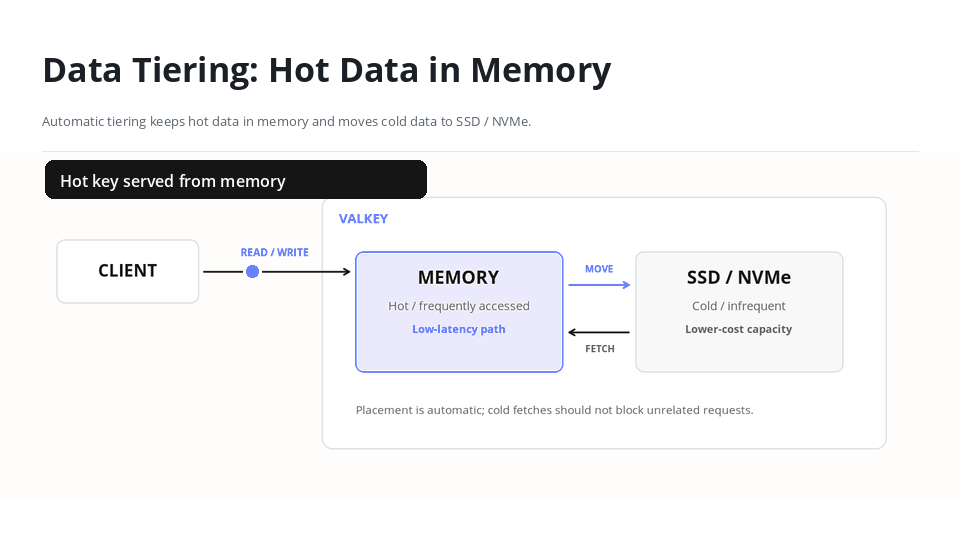

+++
title = "Valkey's Next Chapter: Durability and Beyond"
date = 2026-10-29
description = "Technical recap of the ValkeyConf 2026 closing keynote by Harkrishn Patro and Viktor Söderqvist. Covers durability, Cluster V2, data tiering, and active-active replication, and more."
authors = ["hpatro", "zuiderkwast", "crystalpham"]

[taxonomies]
blog_type = ["Events"]
+++

  <iframe src="https://www.youtube-nocookie.com/embed/2OaLqzYljlQ" title="Closing Keynote: Valkey's Next Chapter: Durability and Beyond" style="position: absolute; top: 0; left: 0; width: 100%; height: 100%; border: 0;" loading="lazy" allow="accelerometer; autoplay; clipboard-write; encrypted-media; gyroscope; picture-in-picture; web-share" referrerpolicy="strict-origin-when-cross-origin" allowfullscreen></iframe>

> **TL;DR:** Closing keynote recap: Valkey's next chapter focuses on four interconnected areas: durability, Cluster V2, data tiering, and active-active replication. Together, these efforts aim to deliver stronger consistency guarantees, more efficient storage, and geographically distributed writes while preserving Valkey's high-performance architecture.

## Low Latency Is Cool. Losing Data Isn't.

Fast writes are great. But what happens when a node crashes, your dataset outgrows memory, or multiple regions need to write to the same data?

At [ValkeyConf 2026](https://events.linuxfoundation.org/valkeyconf/), Valkey maintainers and Technical Steering Committee (TSC) members [Harkrishn Patro (Apple)](https://uk.linkedin.com/in/harkrishn-patro) and [Viktor Söderqvist (Ericsson)](https://github.com/zuiderkwast) took the stage for the closing keynote, ["Valkey's Next Chapter: Durability and Beyond"](https://www.youtube.com/watch?v=2OaLqzYljlQ), to outline what's next for Valkey 10 and beyond.

Their focus was extending what developers can reliably build with Valkey without sacrificing the performance and simplicity that made it useful in the first place.

## Durability: If Valkey Says "OK," the Write Should Stick

On a single node, Valkey is already durable. With AOF and `appendfsync always`, a write is fsynced to disk before the client sees "OK," so it survives a crash. Across multiple nodes, that guarantee doesn't hold. Replication is asynchronous, so the primary acknowledges a write before its replicas have it. If the primary fails in that window, the promoted replica never saw the write and the acknowledged data is lost.

For caching, that tradeoff is often acceptable. For workloads requiring stronger data guarantees, it becomes a limitation.

The proposed durability work introduces synchronous replication and stronger consistency.

When a write arrives, the primary applies it in-memory but marks the affected keys as uncommitted. The system continues processing commands while holding responses that depend on uncommitted data until the required replication acknowledgments arrive.

Replicas also avoid exposing uncommitted writes, ensuring clients don't read data that could disappear after failover.

Disk persistence introduces another consideration. With append-only files (AOF), changes must be written and synchronized using `fsync` before acknowledgment. Periodic RDB snapshots alone cannot provide the same durability guarantees.

Viktor also discussed achieving durability through synchronous replication without local disk persistence. This approach depends on preventing failed nodes from restarting with stale state, particularly in ephemeral Kubernetes environments.

## Cluster V2: Gossip Has Its Limits

Valkey's existing cluster architecture relies on a full-mesh gossip protocol for node communication, failure detection, and topology changes.

Each node maintains its own view of the cluster, exchanging updates asynchronously. While effective for existing deployments, this approach introduces scalability limitations as clusters grow.

During testing with approximately 1,000 nodes, cluster communication alone consumed around 5% CPU, even without application traffic.

Cluster V2 proposes a different approach using Raft, a leader-based distributed consensus algorithm.

Instead of nodes independently propagating topology changes, Raft elects a leader to coordinate cluster-level decisions. Changes are committed after acknowledgment from a majority of participating nodes, providing a consistent view of cluster metadata.

This matters because **durability and cluster coordination are closely connected.**

Synchronous replication requires reliable agreement on which replicas are eligible for failover. If nodes disagree about cluster membership or topology, data might be acknowledged by an inactive node and return inconsistent results to the user.

## Data Tiering: Not Every Key Needs to Stay In-Memory

Valkey's in-memory architecture delivers high throughput and low latency, but keeping increasingly large datasets entirely in-memory comes at a cost.

Data tiering, one of the community's most requested capabilities, aims to separate frequently accessed data from colder data.

Under the proposed design, hot data remains in-memory while less frequently accessed data moves to lower-cost storage on disk.

Rather than requiring developers to manually select which keys move between storage tiers, Valkey would automatically determine data placement based on access patterns.

When a client requests cold data, asynchronous retrieval would fetch it from storage without blocking the main thread. Only clients waiting on that data would experience the additional latency, while requests for resident data continue.

Applications could potentially maintain larger datasets without provisioning enough memory to hold every key, preserving in-memory performance for frequently accessed data while reducing overall storage costs.

## Active-Active: Everyone Can Write. Now What?

Active-active replication introduces another challenge: allowing geographically distributed clusters to accept writes simultaneously.

The difficulty isn't simply replicating data between regions. It's determining what happens when different regions modify the same data, particularly during network partitions.

The community is exploring bidirectional replication, replication-state tracking, and conflict-resolution mechanisms to support eventual consistency.

One potential starting point is a mesh topology, where clusters exchange updates directly while avoiding cyclic replication paths.

For conflict resolution, last-write-wins is being considered as an initial approach. However, its simplicity introduces tradeoffs, since the latest write may overwrite another valid update.

Conflict-free replicated data types (CRDTs) are also being explored as a possible future direction for workloads requiring more sophisticated merge semantics.

Some applications require local writes during partitions, accepting temporary divergence until connectivity returns and state converges.

## Four Features. One Bigger Test: Keep Valkey Simple

These capabilities address different problems, but their underlying architectures overlap.

Durability tracks committed writes. Cluster V2 coordinates distributed state. Data tiering manages data placement. Active-active tracks replication and reconciliation across regions.

Rather than building entirely separate mechanisms, the community is exploring reusable components that keep Valkey maintainable and understandable.

## More Capabilities. Same Valkey Simplicity.

Valkey's next chapter isn't just about making data access faster. It's about making more workloads possible without losing the simplicity that developers depend on.

All of this is still in development, and the design decisions being made now will shape what Valkey becomes next. Follow along or contribute:

- Durability: [#3037](https://github.com/valkey-io/valkey/issues/3037)
- Cluster V2: [#3856](https://github.com/valkey-io/valkey/issues/3856)
- Data tiering: [#3326](https://github.com/valkey-io/valkey/issues/3326)
- Active-active: [#512](https://github.com/valkey-io/valkey/issues/512)

The developers working on these are on the [Valkey Slack](https://valkey.io/slack).
