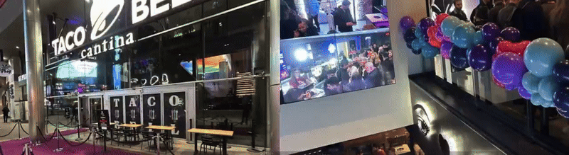

+++
title = "House of Valkey: The Family Reunion"
date = 2026-11-02
description = "​This night is for the builders, the maintainers, the contributors, the curious, and anyone who is all in on open source. Come meet the Valkey community in town for re:Invent."
authors = ["crystalpham"]

featured = false
featured_image = "/assets/media/featured/house-of-valkey.png"

[taxonomies]
blog_type = ["Events"]
+++

<strong>Every conference has an afterparty. This one has a family reunion.</strong> House of Valkey is back in Vegas, and we’ve been making plans for the people who make this community worth showing up for.

  
Your December 1 Plans

  
We Saved You a Seat.

  
<strong>Tuesday, December 1 · 6–10 PM</strong> HaSalon at The Venetian · Las Vegas

  <a class="hov-button" href="https://hubs.la/Q04CT52n0">Register to Join the Family →</a>
  
No AWS re:Invent badge required. Everyone attending needs to register.

<h2>Last Year, We Took Over Taco Bell</h2>

Last year, House of Valkey took over three floors of Taco Bell Cantina in Las Vegas with a custom menu, and spiked Baja Blasts. Turns out, the people you know from GitHub are very good company outside a comment thread. Following a three-story Taco Bell takeover takes some thought, so this year we found a living room big enough for the family.

<figure class="hov-memory">
  
  <figcaption>A little context for everyone who missed last year.</figcaption>
</figure>

<h2>Make Yourself at Home</h2>

HaSalon means “the living room,” which feels appropriate for a community whose usual gathering places involve browser tabs. We love a good GitHub thread, but sometimes you want to finish a conversation without opening another issue.

On December 1, we’re getting together to catch up, put faces to familiar handles, and finally talk without calculating somebody else’s time zone. We’ve also been working on a few reasons to leave some room in your suitcase.

  

    <strong>We Got You Something</strong>
    House of Valkey swag is part of the family welcome.
  

  

    <strong>Stay a Little Longer</strong>
    We have fun activities lined up for the evening.
  

  

    <strong>We’re Keeping Secrets</strong>
    A few surprises are better shared in person.
  

<h2>You’re Part of the Family</h2>

Valkey brings together people who write code, run it, build businesses around it, explain it to their coworkers, and ask questions that make the whole project better. House of Valkey is for all of them, including the people who are still learning what Valkey is.

Bring your team or the friend who’s heard you say “Valkey” enough times to finally investigate. Come solo and give us a chance to introduce you around. Nobody needs a merged pull request to get a welcome here, but everyone needs to register.

In Vegas for AWS re:Invent, living nearby, or just happening to be in town? Come spend the evening with us. Your conference badge can take the night off.

  
Last year was Taco Bell and Baja Blasts. <strong>We’d love to have you in the room for this chapter.</strong> Register yourself and send the link to whoever’s coming with you.

  <a class="hov-button" href="https://hubs.la/Q04CT52n0">Save Your Seat →</a>

