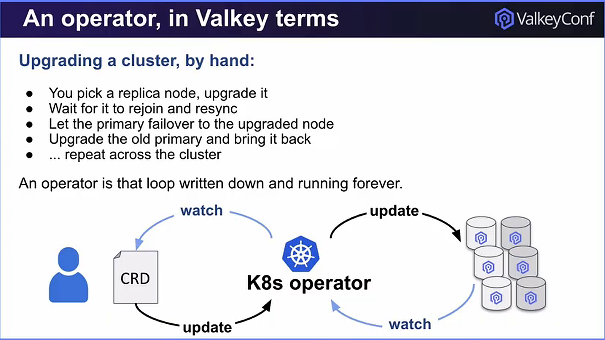
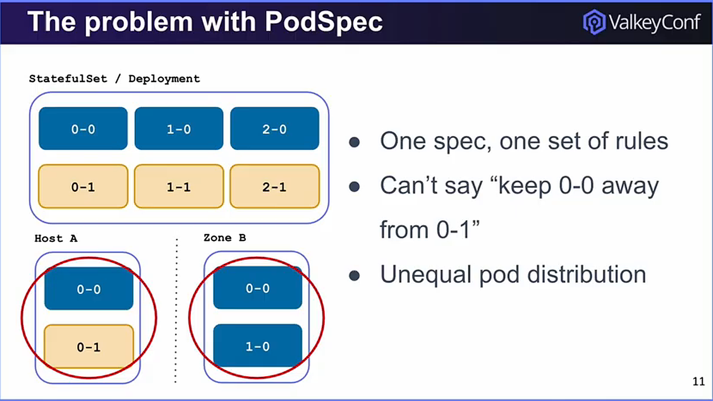
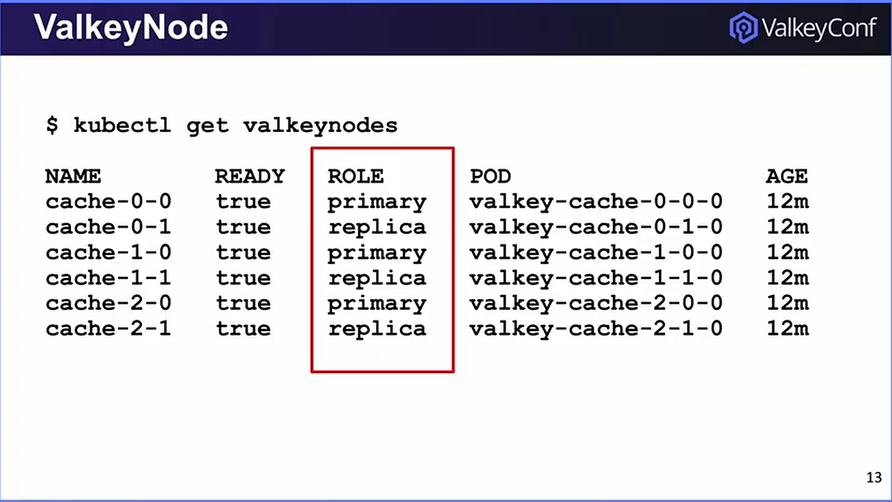
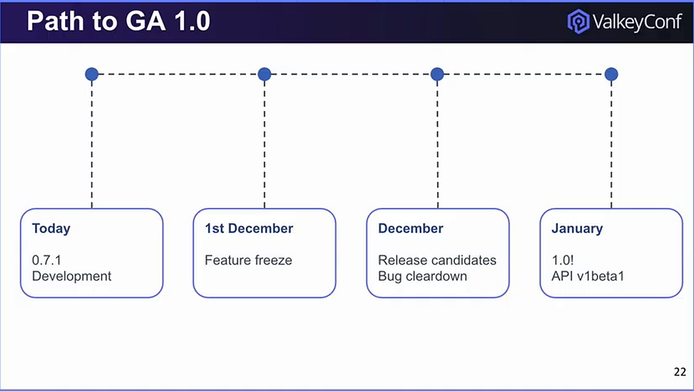

+++
title = "One Year From the Hallway: The State of the Valkey Operator"
date = 2026-11-05
description = "From a hallway conversation to Kubernetes cluster management, Valkey Operator maintainers Joe Heyburn and Björn Svensson share what's been built and the road to 1.0."
authors = ["crystalpham"]

[taxonomies]
blog_type = ["Events"]
+++

  <iframe
    src="https://www.youtube-nocookie.com/embed/Qhpx5Tl92nE"
    title="One Year From the Hallway: The State of the Valkey Operator"
    style="position: absolute; top: 0; left: 0; width: 100%; height: 100%; border: 0;"
    loading="lazy"
    allow="accelerometer; autoplay; clipboard-write; encrypted-media; gyroscope; picture-in-picture; web-share"
    allowfullscreen>
  </iframe>

> **TL;DR:** Valkey can run on Kubernetes, but managing distributed clusters takes more than keeping pods alive. One year after a hallway conversation sparked the effort, Valkey Operator maintainers Joe Heyburn and Björn Svensson returned to ValkeyConf 2026 to discuss cluster reconciliation, topology-aware scheduling, access controls, and the road to 1.0.

## Valkey on Kubernetes? Here's Where It Gets Interesting.

Valkey is known for its speed as an open source, in-memory data store. But what happens when you need to run and manage Valkey clusters on Kubernetes?

Kubernetes can restart a failed pod. What it doesn't automatically understand is which Valkey node should become primary, where replicas belong, or how to upgrade a cluster without disrupting traffic.

That's where the [Valkey Operator](https://github.com/valkey-io/valkey-operator) comes in.

A Kubernetes Operator extends Kubernetes with application-specific knowledge. For Valkey, the goal is to automate cluster deployment, failover, upgrades, and recovery instead of coordinating them manually.

The idea started with a hallway conversation at Valkey Keyspace in Amsterdam. One year later, at ValkeyConf 2026 in Prague, Valkey Operator maintainers Joe Heyburn of Braze and Björn Svensson of Ericsson showed what the community has built since then and what's next.

## An Operator Is More Than a YAML Generator

Kubernetes is good at keeping declared workloads running. A Valkey cluster has additional rules: primaries own hash slots, replicas follow specific primaries, and membership changes must respect data state.

During upgrades, the operator must handle failover, replace containers, and verify replication without interruption.

A Kubernetes operator turns that operational knowledge into a reconciliation loop. Users describe the desired cluster through a custom resource, and a controller watches actual state and moves it toward that desired configuration.

The Valkey Operator's initial design deliberately prioritizes **cluster mode**, zero-downtime lifecycle operations, resilience, security, and observability. Standalone, primary-replica, and Sentinel deployments have different semantics.

## Why One PodSpec Doesn't Solve Placement

A StatefulSet gives pods a shared template and scheduling policy. But a Valkey cluster needs more specific placement decisions. Separating pods matters only if the *right* instances are separated. A primary and its replica should not share a failure domain.

Generic pod affinity rules don't automatically understand shard identity, primary/replica relationships, or the consequences of losing a particular host.

The operator introduces placement controls at the Valkey topology level, including scheduling modes for distributing primaries and replicas across infrastructure. In the session, the team showed how **required** and **preferred** placement policies express the difference between a hard rule and a best-effort preference.

Hard constraints protect availability but can leave pods unscheduled when capacity is tight. The tradeoff needs to be explicit.

## Meet ValkeyNode: A Smaller Unit of Control

The architecture also introduces a `ValkeyNode` resource alongside `ValkeyCluster`.

A cluster-level resource captures the intended deployment, including shard and replica counts. Node-level resources give the controller a way to reason about individual instances and their roles as Kubernetes objects and Valkey topology change independently.

The presentation walked through the ownership chain from `ValkeyCluster` to Kubernetes workloads and pods, and showed how `ValkeyNode` participates in reconciliation. A `kubectl get valkeynodes` example made the model tangible: the operator exposes node identity, readiness, and primary/replica roles through the Kubernetes API.

A healthy pod doesn't necessarily mean a healthy Valkey cluster.

## ACLs and Day-Two Operations Are Part of the Design

Security isn't something the project plans to bolt on after the happy-path demo.

The session showed declarative Valkey access-control lists (ACLs), including users, command permissions, and key-access patterns. Managing permissions alongside the cluster specification makes configuration repeatable rather than relying on ad hoc commands issued after deployment.

The team also demonstrated the operator managing a cluster in real time. Kubernetes resources and Valkey state changed through the controller, not manual coordination.

There is still substantial work ahead. The public repository continues to describe the `v1alpha1` API as **early development and not production-ready**. That warning matters more than any demo: controller correctness needs to hold under node failure, interrupted upgrades, and partial recovery, not just when everything goes according to plan.

## From Hallway Idea to 200+ Merged PRs

The community growth is part of the technical story. The speakers reported **more than 200 merged pull requests** and **over 25 contributors from multiple companies**. Those contributions cover implementation, testing, and the operational edge cases that determine reliability.

The roadmap presented at ValkeyConf targeted a December 2026 feature freeze and release candidates, followed by a January 2027 1.0 milestone with a `v1beta1` API. These were **planned milestones**, not a claim that general availability had already shipped.

The longer-term ideas are broader still: backup and restore, autoscaling, external access, rollout strategies, and support for more deployment patterns. The presenters also introduced `ValkeyCell` as a possible abstraction for groups of standalone Valkey instances and non-cluster-compatible workloads.

But the team's immediate challenge is clear: make the cluster lifecycle predictable before expanding the surface area.

## The Real Feature Is Less Manual Recovery

Kubernetes could already run Valkey. Operating it correctly was the harder problem.

Now there's a growing community putting that knowledge into a controller, one reconciliation and one failure scenario at a time. The 1.0 milestone matters, but the bigger test is whether the operator can turn fragile runbooks into repeatable behavior without taking control away from developers and operators.

**Kubernetes handles the pods. The Valkey Operator is being built to understand the cluster.**

Follow the work, review the open design decisions, or contribute at [github.com/valkey-io/valkey-operator](https://github.com/valkey-io/valkey-operator).