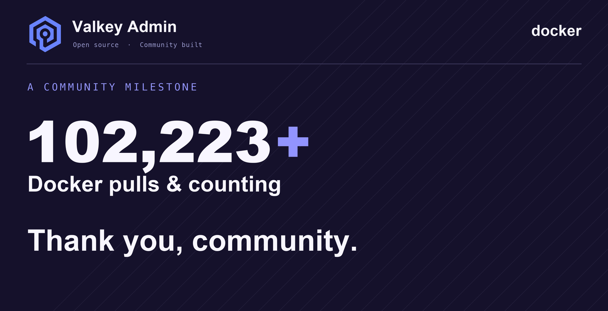
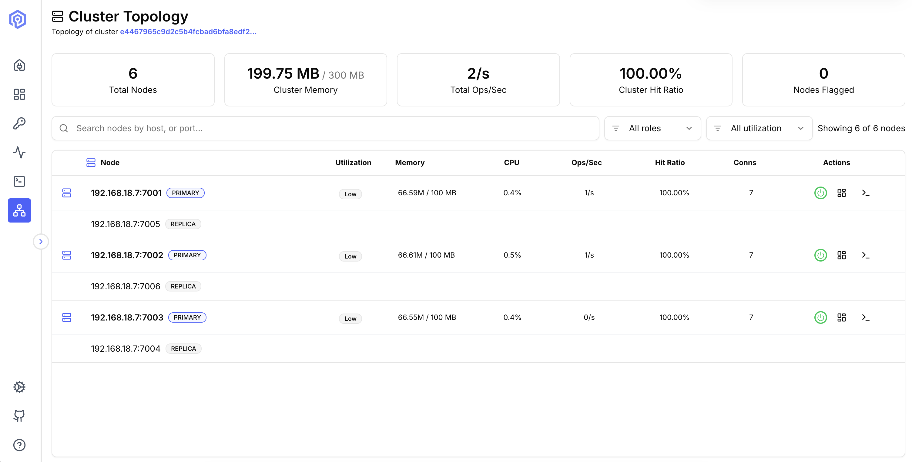
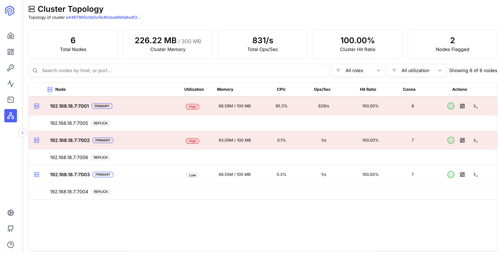
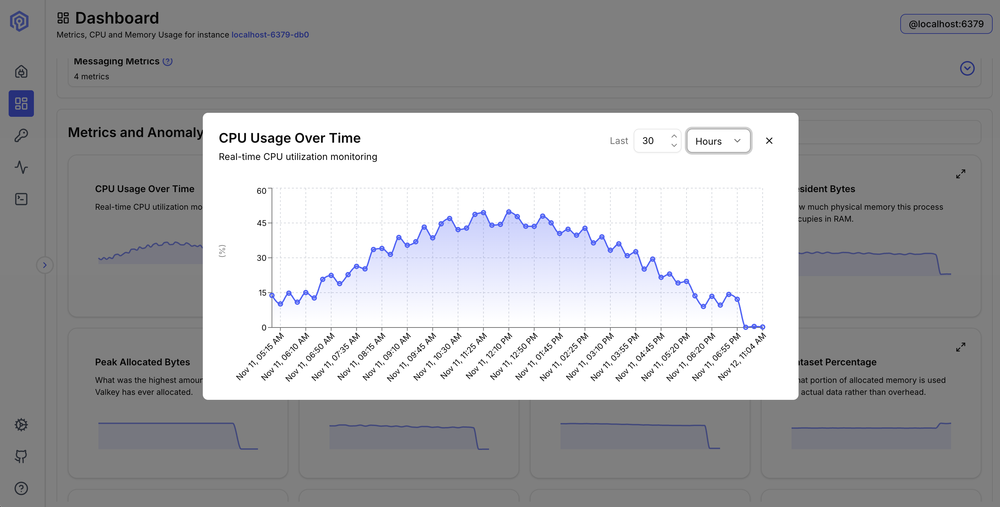
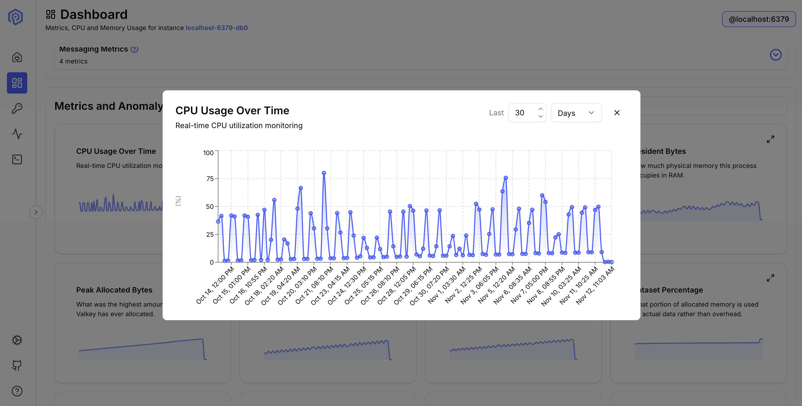
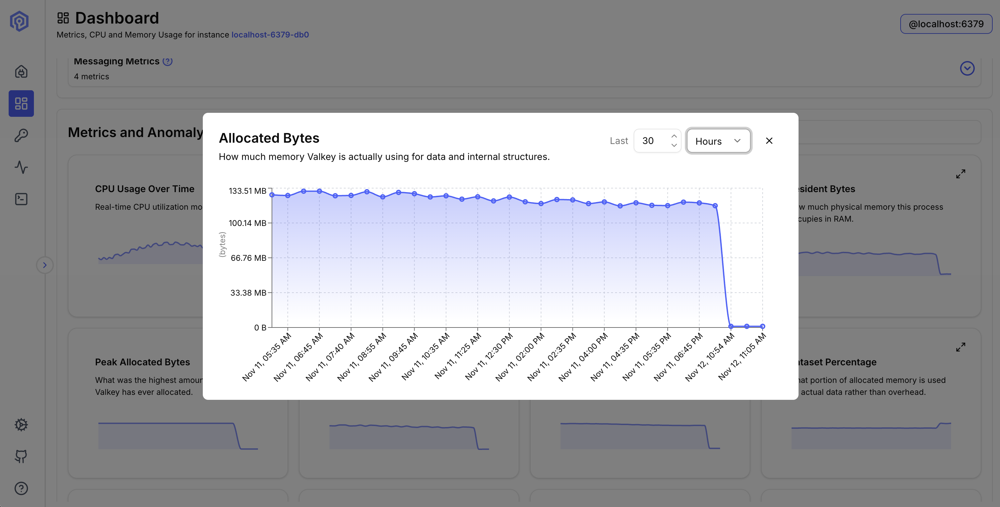
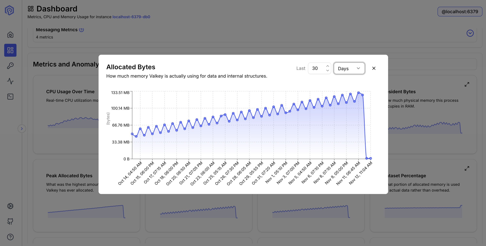

# <textStyle t="gray-6">Valkey Admin 1.2 and 1.3: 100K Docker pulls and what's new</textStyle>

Announcements · November 2026 · *Maryna Boryshkevych, Rong Zhang*

*100,000+ Docker pulls. Two new releases, 1.2 and 1.3. And a community that's just getting started.*

---

There's something special about watching an open source project grow.

It starts with an idea, a problem worth solving, and a few people willing to build something better. Then comes the first release, the first issue, the first pull request from someone outside the original team. <textStyle t="gray-6">In 1.3, the project welcomed a few more first-time contributors.</textStyle> And eventually, you look at Docker Hub and see a number you weren't expecting quite so soon.

**100K+ pulls.**

That's the milestone Valkey Admin just reached, and we couldn't be more excited!

Docker pulls aren't the same as unique users, of course. But they tell us something encouraging: people are discovering Valkey Admin, trying it, and bringing it into their workflows. For our team and the contributors helping build this project, that's a great reason to celebrate.

But this isn't just a post about a number. It's about why we started, what's new in versions 1.2 and 1.3, and, most of all, where we hope to go together. <textStyle t="gray-6">Next, we're exploring an MCP server to empower Valkey users to troubleshoot with AI agents, and OpenTelemetry metrics export so they can keep using the monitoring tools they already have.</textStyle>



## It started with a familiar problem

If you've operated a distributed Valkey cluster, you know the routine.

Your application slows down. Cache latency climbs. One node seems busier than the others. So you open a terminal. Then another. Maybe a monitoring dashboard. Then `valkey-cli`, a few `INFO` commands, some key inspection, and a little mental gymnastics to piece together what's happening across the cluster.

The tools work. The hard part is connecting all the pieces quickly.

We wanted to make that simpler: see your cluster, understand its behavior, inspect your data, and investigate performance from one place. That idea became Valkey Admin, an open source, visual companion to the tools you already trust, not a replacement for them.

Our [first stable releases](https://valkey.io/blog/introducing-valkey-admin-1-0-visual-cluster-management-for-valkey/) brought the essentials together: real-time dashboards, a key browser, command execution, cluster topology, and troubleshooting tools. <textStyle t="gray-6">1.1 added</textStyle> [<textStyle t="gray-6">big key detection</textStyle>](https://valkey.io/blog/finding-big-keys-in-a-running-valkey-cluster/)<textStyle t="gray-6">.</textStyle> But as anyone who builds developer tools knows, the first release is really the start of the conversation. Here's where that conversation went next.

## Version 1.2: from seeing your cluster to understanding it

A topology diagram tells you which nodes are primaries, which are replicas, and how the cluster is organized. But when something breaks, the question usually isn't "where are my nodes?" It's "**which one needs my attention?**"

That's the heart of Valkey Admin 1.2, released in September 2026.

### Cluster topology, now with utilization

The Cluster Topology view now shows not just structure, but load.

- Cluster-level summaries for memory, ops/sec, hit ratio, node count, and nodes that need attention.
- Per-node detail: CPU, memory usage, connected clients, ops/sec, and hit ratio.
- A simple **Low / Normal / High** badge on each primary. High is flagged at 90%+ memory or 85%+ CPU, so an overloaded node is easy to spot.
- Filter by role or utilization, with the view refreshing every five seconds while open.

A small change with a clear goal: spend less time hunting for the problem, and more time solving it.



**Topology with healthy nodes** Valkey Admin Cluster Topology view listing each primary node with its replica.



**Topology with a flagged nodes** Valkey Admin Cluster Topology view listing each primary node with its replica.

▶ **Watch the 1.2 demo:** [See your whole cluster's utilization at a glance](https://www.youtube.com/shorts/-812isos-0k) (under a minute).

### A better everyday experience

1.2 also brought smaller improvements that add up in daily use: more flexible Key Browser search, string edits that preserve existing TTLs, and safeguards against accidentally overwriting a key.

And we invested in **safer defaults**: more restrictive network binding, authenticated metrics-collector registration, stronger TLS verification, and extra protection for desktop connections. A good admin tool should help you troubleshoot your infrastructure, not become a new thing to worry about.

## Version 1.3: follow the heat, see the history, strengthen isolation

If 1.2 helped answer "which node looks busy?", version 1.3, released in October 2026, takes the investigation further, with deeper visibility and important improvements to how connections are isolated.

### Hot Slots: when the heatmap tells the story

Distributed systems are good at hiding uneven workloads. You can have plenty of capacity overall while a few hash slots carry most of the activity.

<textStyle t="gray-6">1.3 adds a **Slots** tab to the **Hot Keys heatmap**. It groups your top hot keys by hash slot, and each slot is a tile, colored by how many of those keys it has.</textStyle>. See something interesting? Click it. You can inspect the keys in that slot, with size, TTL, and owning node, and open any key straight in the Key Browser.

The path becomes natural: spot the hot slot → inspect its keys → understand the workload. (Hot slots needs Valkey 8.0+, cluster mode, `cluster-slot-stats-enabled yes`, and an LFU eviction policy. <textStyle t="gray-6">Without these, Valkey Admin prompts you to start MONITOR-based detection, which has a performance impact on the server ([Activity docs](https://valkey-admin.valkey.io/features/activity/))</textStyle>

### More history, fewer guesses

Fixed time-range buttons are gone. You can now pick a custom window, in hours or days, up to 30 days, which makes questions like these much easier to answer:

- Was this memory growth gradual, or sudden?
- Does CPU utilization follow a recurring pattern?
- Was this behavior there before the last deployment?




**CPU, 30 days with spikes** Valkey Admin CPU usage chart for the last 30 hours



**CPU, 30 days with spikes** Valkey Admin CPU usage chart for the last 30 days

One detail: longer windows still need enough metrics retention configured. <textStyle t="gray-6">Each node keeps about a day of history by default, and ([Keeping more history](https://valkey-admin.valkey.io/configuration/metrics/#keeping-more-history)<textStyle t="gray-6">) shows how to keep up to 30 days.</textStyle> We also added command execution timing to Send Command, so you can see how long each command took.



**Memory, 30-day chart** Valkey Admin memory chart for the last 30 hours



**Memory, 30-day chart** Valkey Admin memory chart for the last 30 days

▶ **Watch the 1.3 demo:** [Look back 30 days at CPU and memory](https://www.youtube.com/shorts/6tbHtWjC5A0) (under a minute).

### Stronger foundations

Some of the most important work in 1.3 doesn't show up in a screenshot.

1.3 introduces stronger server-side isolation based on your Valkey identity and the deployment you connect to. Clients, topology state, and metrics collectors are scoped to the right owner, commands run with your own Valkey credentials, and the server validates those credentials against the endpoint you named. It also strengthens protections around WebSocket connections and authentication attempts. <textStyle t="gray-6">1.3 also adds [IAM authentication for Google Cloud Memorystore for Valkey](https://github.com/valkey-io/valkey-admin/pull/508)<textStyle t="gray-6">.</textStyle>

There are upgrade considerations worth thirty seconds before you roll out. <textStyle t="gray-6">1.3 keeps history separately for each Valkey identity and deployment, so dashboards start a fresh history after the upgrade. If you changed collector settings, apply them again.</textStyle> Deployments reached through a DNS hostname may need an explicit WebSocket origins allowlist. And in Kubernetes mode, collector-backed features are temporarily unavailable in 1.3, because the current sidecar credential model can't provide the required per-user isolation. We encourage existing users to skim the release notes first here <textStyle t="gray-6">[What's New page](https://valkey-admin.valkey.io/releases/).</textStyle> For us, improving the foundations matters as much as adding visible features.

## Want to give Valkey Admin a spin?

This is a great time to try it. Run it as a desktop app, or deploy the web version with Docker. For a quick local trial on 1.3:

```bash
docker run --rm --name valkey-admin -p 127.0.0.1:8080:8080 valkey/valkey-admin:1.3.0
```

Then open `http://localhost:8080` and connect to your instance or cluster. The local-only port binding is intentional: web mode doesn't ship its own authentication, so any deployment others can reach should sit behind proper access controls.

Once you're in, start with the cluster topology, browse a few keys, and explore the activity views. If something feels confusing or missing, we genuinely want to know. Docs, setup guides, and detailed release notes live at [valkey-admin.valkey.io](https://valkey-admin.valkey.io).

## The best part of open source? Let's build it together.

Reaching 100K Docker pulls is exciting. What motivates us more is building a tool that reflects the people who use Valkey every day.

Every deployment is different. Some of you are debugging locally; others are running large clusters, using managed Valkey services, or working through complex Kubernetes setups. Those experiences surface problems and ideas no single team can anticipate, which is exactly why we want to build Valkey Admin *with* the community, not just in the open.

So tell us about the real workflows you want to simplify. What's still too hard when you troubleshoot a cluster? Which metrics are hardest to read? Where could the interface be clearer?

Collaborating doesn't have to mean shipping a major feature. A reproducible bug report, a better workflow idea, a docs fix, testing against a different environment, or reviewing a design all make the project stronger. And if you're excited to write code, let's build it together, for larger changes, open a GitHub issue and a design discussion so we can shape the approach side by side.

## A thank-you, and an invitation

Behind these releases are a lot of engineering decisions, code reviews, debugging sessions, and small improvements that never make a headline.

A special thank-you to the people behind these releases. [@nassery318](https://github.com/nassery3180) built the utilization view, the Hot Slots tab and the 30-day CPU and memory history. [@ArgusLi](https://github.com/ArgusLi) built per-user isolation for shared deployments. [@ravjotbrar](https://github.com/ravjotbrar) led along list of security hardening, along with the Big Keys scan and smarter Key Browser search. [@tkesgar](https://github.com/tkesgar) made Valkey Admin work behind a reverse proxy subpath. 

These releases also welcomed first-time contributors: 
[@rezakaramad](https://github.com/rezakaramad) - GCP Memorystore IAM auth (https://github.com/valkey-io/valkey-admin/pull/508),
[@bharathsr08](https://github.com/Bharath5626) - blocking connection-state commands (https://github.com/valkey-io/valkey-admin/pull/534) and [@RajGahoi](https://github.com/Bharath5626) - command timing ([https://github.com/valkey-io/valkey-admin/pull/553](https://github.com/valkey-io/valkey-admin/pull/553)). 

Thank you to [@michaelstingl](https://github.com/michaelstingl), [@dbaker-arch](https://github.com/dbaker-arch) and [@antonin-suzor](https://github.com/antonin-suzor) for contributing to 1.2 release and to [@phoenixphoebus](https://github.com/phoenixphoebus) for opening issues and pull requests on binary-safe key display, decompression of stored values, and Key Browser pagination.

And thank you to everyone who has pulled the image, tried it out, shared it with a colleague, or opened an issue!

100K pulls is a milestone worth celebrating. But the next one we care about isn't a number, it's more people using, improving, and shaping Valkey Admin together.

So here's our invitation: tell us what's missing, and come build with us. <textStyle t="gray-6">Try 1.3 and open an issue for anything you'd like to see.</textStyle> Let's make Valkey operations easier, more visible, and more approachable for everyone.

Here's to the next chapter. 🎉

**Get involved**

- Try Valkey Admin: [valkey-admin.valkey.io](https://valkey-admin.valkey.io)
- Explore the code: [github.com/valkey-io/valkey-admin](https://github.com/valkey-io/valkey-admin)
- See what's new: [release notes](https://github.com/valkey-io/valkey-admin/releases)
- Share an idea or issue: [GitHub Issues](https://github.com/valkey-io/valkey-admin/issues)
- Build with us: [contribution guide](https://valkey-admin.valkey.io/development/contributing/)

*100K pulls and counting. The next chapter is ours to build together!*