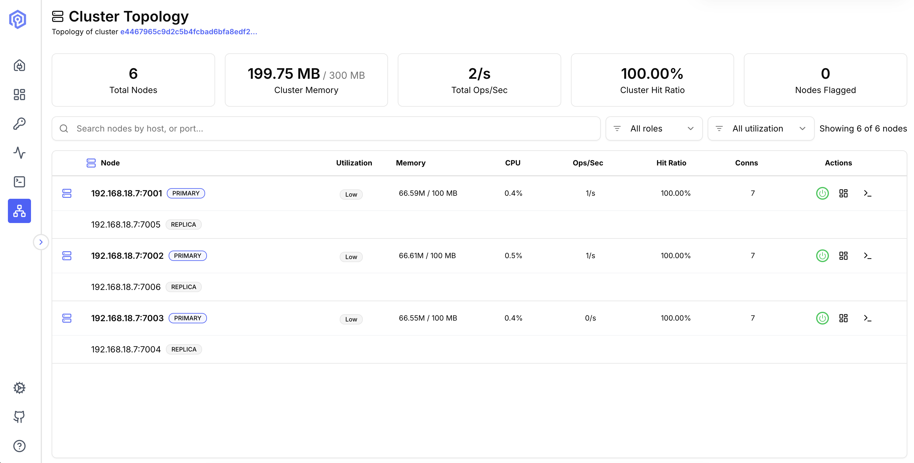
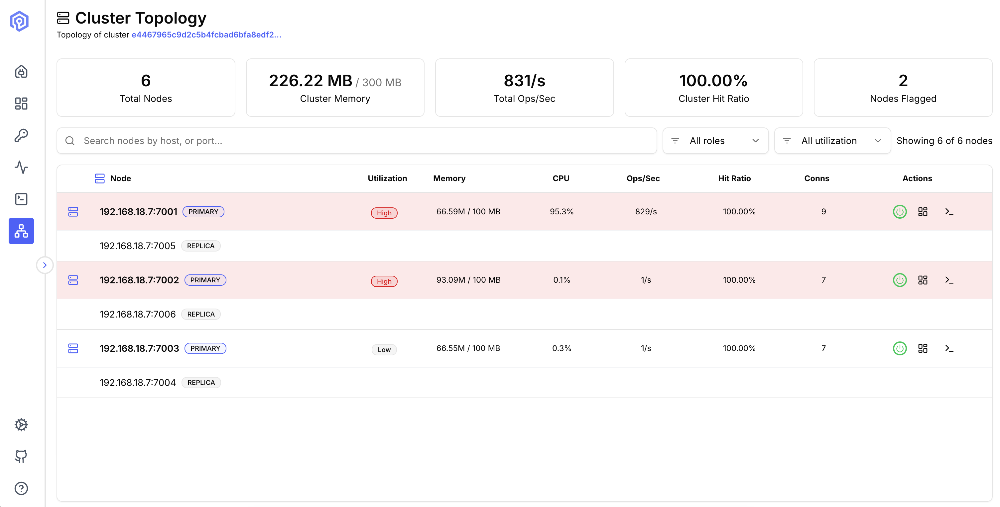
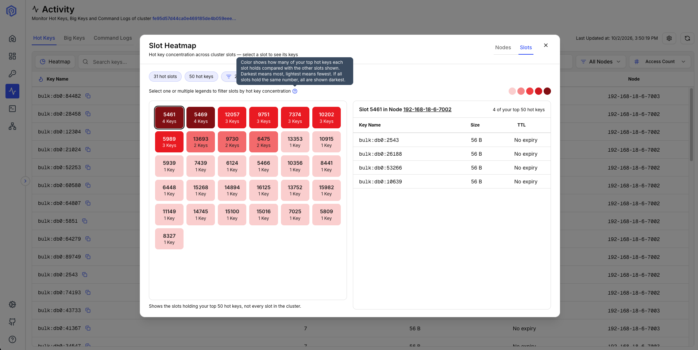
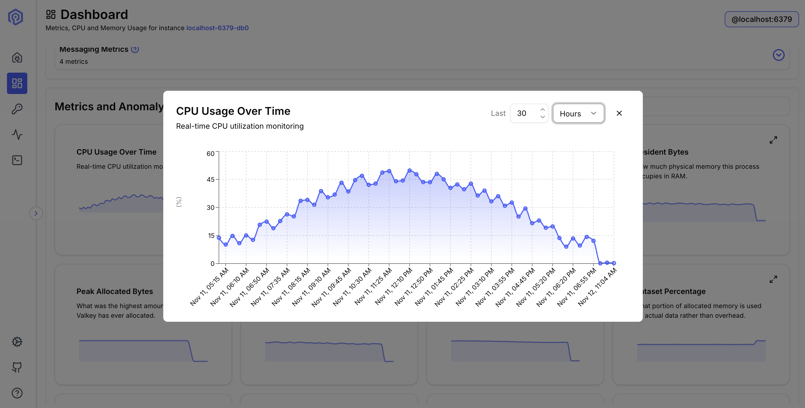
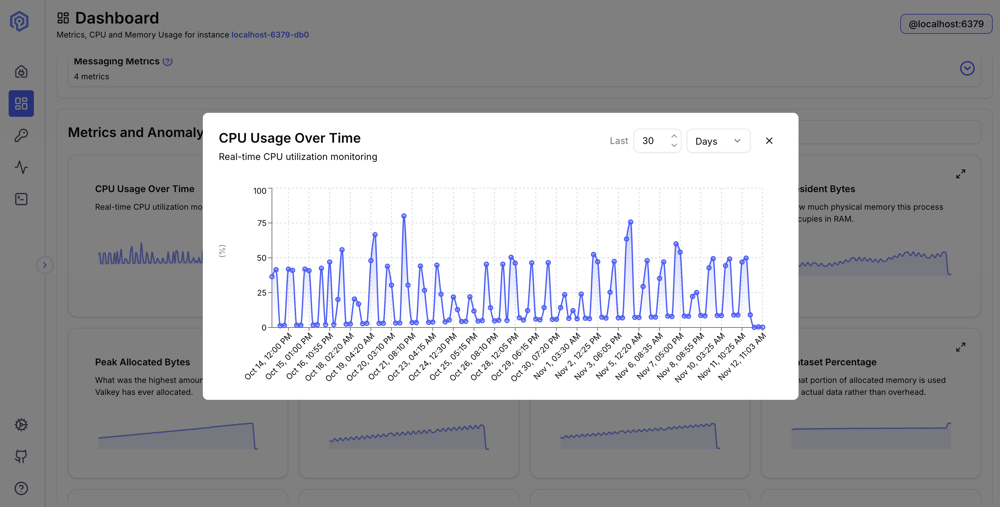
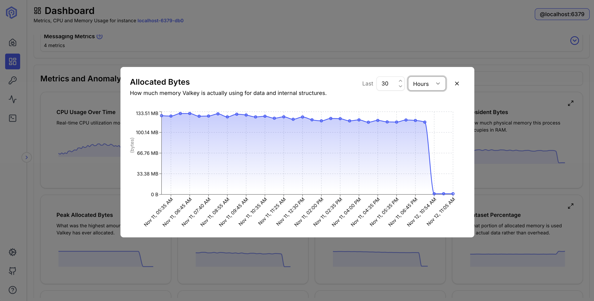
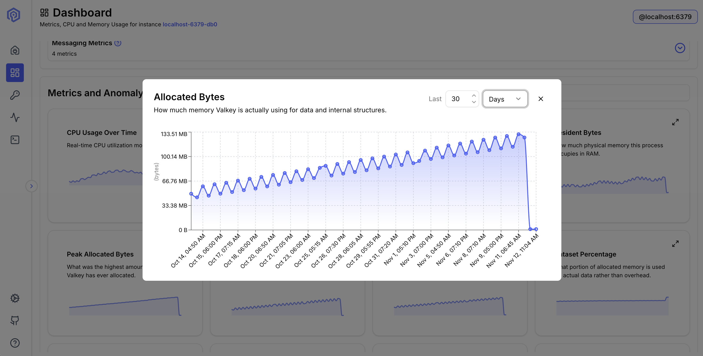
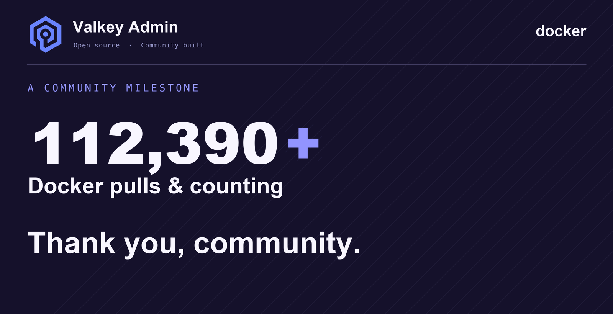

+++
title = "What's new in Valkey Admin 1.2 and 1.3: utilization, hot slots and 30 days of history"
date = 2026-11-11
description = "Valkey Admin 1.2 adds utilization to the cluster topology. 1.3 adds a Hot Slots view, up to 30 days of CPU and memory history, and stronger isolation for shared deployments."
authors = ["marbor", "bblan0803"]

[taxonomies]
blog_type = ["Announcements"]
+++

When a Valkey cluster slows down, the first question is usually "which node or slot needs my attention?" The second is "has it looked like this before?" Valkey Admin 1.2 and 1.3 are built around those two questions. 1.2 adds utilization to the cluster topology, so the busy node stands out. 1.3 adds a Hot Slots view and up to 30 days of CPU and memory history, along with stronger isolation for shared deployments.

We built Valkey Admin to make that kind of investigation simpler: see your cluster, understand its behavior, inspect your data, and investigate performance from one place. It's an open source, visual companion to the tools you already trust.

Our [first stable releases](https://valkey.io/blog/introducing-valkey-admin-1-0-visual-cluster-management-for-valkey/) brought the essentials together: real-time dashboards, a key browser, command execution, cluster topology, and troubleshooting tools. 1.1 added [big key detection](https://valkey.io/blog/finding-big-keys-in-a-running-valkey-cluster/). But as anyone who builds developer tools knows, the first release is really the start of the conversation. Here's where that conversation went next.

## Version 1.2: from seeing your cluster to understanding it

A topology diagram tells you which nodes are primaries, which are replicas, and how the cluster is organized. 1.2 adds the missing piece: how much load each node is carrying.

That's the heart of Valkey Admin 1.2, released in September 2026.

### Cluster topology, now with utilization

The Cluster Topology view now shows not just structure, but load.

- Cluster-level summaries for memory, ops/sec, hit ratio, node count, and nodes that need attention.
- Per-node detail: CPU, memory usage, connected clients, ops/sec, and hit ratio.
- A simple **Low / Normal / High** badge on each primary. High is flagged at 90%+ memory or 85%+ CPU, so an overloaded node is easy to spot.
- Filter by role or utilization, with the view refreshing every five seconds while open.

A small change with a clear goal: spend less time hunting for the problem, and more time solving it.





**Watch the 1.2 demo:** see your whole cluster's utilization at a glance (under a minute).



### A better everyday experience

1.2 also brought smaller improvements that add up in daily use: more flexible Key Browser search, string edits that preserve existing TTLs, and safeguards against accidentally overwriting a key.

And we invested in **safer defaults**: more restrictive network binding, authenticated metrics-collector registration, stronger TLS verification, and extra protection for desktop connections. A good admin tool should help you troubleshoot your infrastructure, not become a new thing to worry about.

## Version 1.3: follow the heat, see the history, strengthen isolation

If 1.2 helped answer "which node looks busy?", version 1.3, released in October 2026, takes the investigation further, with deeper visibility and important improvements to how connections are isolated.

### Hot Slots: when the heatmap tells the story

Distributed systems are good at hiding uneven workloads. You can have plenty of capacity overall while a few hash slots carry most of the activity.

1.3 adds a **Slots** tab to the **Hot Keys heatmap**. It groups your top hot keys by hash slot, and each slot is a tile, colored by how many of those keys it has. See something interesting? Click it. You can inspect the keys in that slot, with size, TTL, and owning node, and open any key straight in the Key Browser.



The path becomes natural: spot the hot slot → inspect its keys → understand the workload. Hot Slots detection needs Valkey 8.0+, cluster mode, `cluster-slot-stats-enabled yes`, and a least frequently used (LFU) eviction policy. Without these, Valkey Admin prompts you to start `MONITOR`-based detection, which has a performance impact on the server ([Activity docs](https://valkey-admin.valkey.io/features/activity/)).

### More history, fewer guesses

Fixed time-range buttons are gone. You can now pick a custom window, in hours or days, up to 30 days, which makes questions like these much easier to answer:

- Was this memory growth gradual, or sudden?
- Does CPU utilization follow a recurring pattern?
- Was this behavior there before the last deployment?





One detail: longer windows still need enough metrics retention configured. Each node keeps about a day of history by default, and [Keeping more history](https://valkey-admin.valkey.io/configuration/metrics/#keeping-more-history) shows how to keep up to 30 days. We also added command execution timing to Send Command, so you can see how long each command took.





**Watch the 1.3 demo:** look back 30 days at CPU and memory (under a minute).



### Stronger foundations

Some of the most important work in 1.3 doesn't show up in a screenshot.

1.3 introduces stronger server-side isolation based on your Valkey identity and the deployment you connect to. Clients, topology state, and metrics collectors are scoped to the right owner, commands run with your own Valkey credentials, and the server validates those credentials against the endpoint you named. It also strengthens protections around WebSocket connections and authentication attempts. 1.3 also adds [Identity and Access Management (IAM) authentication for Google Cloud Memorystore for Valkey](https://github.com/valkey-io/valkey-admin/pull/508).

There are upgrade considerations worth thirty seconds before you roll out. 1.3 keeps history separately for each Valkey identity and deployment, so dashboards start a fresh history after the upgrade. If you changed collector settings, apply them again. Deployments reached through a DNS hostname may need an explicit WebSocket origins allowlist. And in Kubernetes mode, collector-backed features are temporarily unavailable in 1.3, because the current sidecar credential model can't provide the required per-user isolation. We encourage existing users to skim the [What's New page](https://valkey-admin.valkey.io/releases/) first. For us, improving the foundations matters as much as adding visible features.

## Try it

Run Valkey Admin as a desktop app, or deploy the web version with Docker. For a quick local trial on 1.3:

```bash
docker run --rm --name valkey-admin -p 127.0.0.1:8080:8080 valkey/valkey-admin:1.3.0
```

Then open `http://localhost:8080` and connect to your instance or cluster. The local-only port binding is intentional: web mode doesn't ship its own authentication, so any deployment others can reach should sit behind proper access controls.

Once you're in, start with the cluster topology, check the Hot Slots tab, and widen the time range on the CPU and memory charts. Docs, setup guides, and detailed release notes live at [valkey-admin.valkey.io](https://valkey-admin.valkey.io).

## What's next

We're working on OpenTelemetry metrics export, so you can send the metrics Valkey Admin collects to the monitoring tools you already use. We're also exploring a Model Context Protocol (MCP) server, so you can troubleshoot Valkey with AI agents using the same views Valkey Admin gives you today.

## Thank you, and an invitation

A special thank-you to the people behind these releases. [@nassery318](https://github.com/nassery318) built the utilization view, the Hot Slots tab and the 30-day CPU and memory history. [@ArgusLi](https://github.com/ArgusLi) built per-user isolation for shared deployments. [@ravjotbrar](https://github.com/ravjotbrar) led a long list of security hardening, along with the Big Keys scan and smarter Key Browser search. [@tkesgar](https://github.com/tkesgar) made Valkey Admin work behind a reverse proxy subpath.

These releases also welcomed first-time contributors: [@rezakaramad](https://github.com/rezakaramad) ([GCP Memorystore IAM auth](https://github.com/valkey-io/valkey-admin/pull/508)), [@bharathsr08](https://github.com/bharathsr08) ([blocking connection-state commands](https://github.com/valkey-io/valkey-admin/pull/534)) and [@RajGahoi](https://github.com/RajGahoi) ([command timing](https://github.com/valkey-io/valkey-admin/pull/553)).

Thank you to [@michaelstingl](https://github.com/michaelstingl), [@dbaker-arch](https://github.com/dbaker-arch) and [@antonin-suzor](https://github.com/antonin-suzor) for their first contributions in 1.1, and to [@phoenixphoebus](https://github.com/phoenixphoebus) for opening issues and pull requests on binary-safe key display, decompression of stored values, and Key Browser pagination.

And thank you to everyone who has pulled the image, tried it out, shared it with a colleague, or opened an issue. Together you've helped Valkey Admin pass 100,000 Docker pulls.



Every deployment is different. Some of you are debugging locally, and others are running large clusters, using managed Valkey services, or working through complex Kubernetes setups. Those experiences surface problems and ideas no single team can anticipate, which is exactly why we want to build Valkey Admin *with* the community, not just in the open.

So here's our invitation: try 1.3 and open an issue for anything you'd like to see. Let's make Valkey operations easier, more visible, and more approachable for everyone.

Here's to the next chapter.

**Get involved**

- Try Valkey Admin: [valkey-admin.valkey.io](https://valkey-admin.valkey.io)
- Explore the code: [github.com/valkey-io/valkey-admin](https://github.com/valkey-io/valkey-admin)
- See what's new: [What's New page](https://valkey-admin.valkey.io/releases/)
- Share an idea or issue: [GitHub Issues](https://github.com/valkey-io/valkey-admin/issues)
- Build with us: [contribution guide](https://valkey-admin.valkey.io/development/contributing/)
