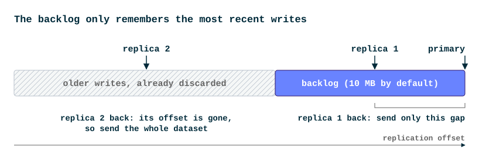
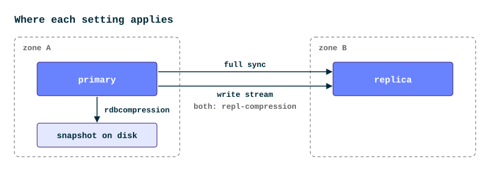
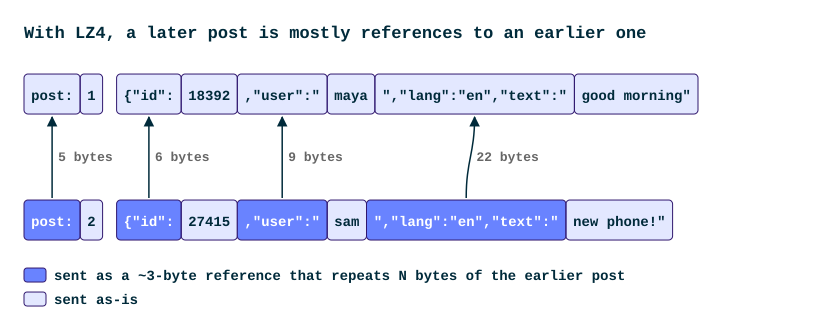
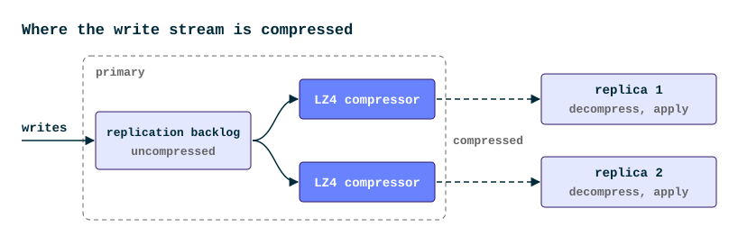

+++
title = "Long Story Short: Compressing Replication and Snapshots in Valkey 9.2"
date = 2026-11-16
description = "Valkey 9.2 can compress replication traffic and RDB snapshots with LZ4 or Zstandard. On a cache of 3 million JSON posts, LZ4 halved the write stream sent to a replica, and full syncs took 36% less time than with the default."
authors = ["sarthakaggarwal97"]

[taxonomies]
blog_type = ["Technical Deep Dive"]

[extra]
featured = false
featured_image = "/assets/media/featured/streaming-compression.webp"
+++

A Valkey primary sends every write it receives to each of its replicas.
When a replica runs in another availability zone or region, cloud providers usually charge for every byte of that traffic.

Valkey has compressed snapshots by default for years, with `rdbcompression yes`, but that only covers part of replication traffic.
It compresses snapshots one value at a time, and steady-state replication, the ongoing stream of writes, is not compressed at all.

Valkey 9.2 adds `repl-compression`, which uses LZ4, a fast general-purpose compressor, on everything the primary sends a replica.
`rdbcompression` can now use LZ4 for snapshots on disk too.

Consider an example: a social app caches its posts in Valkey as JSON documents, with the primary in one availability zone and a replica in another, so the cache survives losing a zone.
Everything below applies to any application whose values share a structure, such as sessions, user profiles, or product records.

## How a replica keeps up

The primary keeps the most recent part of its write stream in a buffer called the replication backlog, sized by `repl-backlog-size` (10 MB by default).
When a replica reconnects after a short disconnect, it sends its replication offset, the number of bytes of the stream it has already processed.
If that offset is still in the backlog, the primary sends only what came after it.
This is a partial sync.

<picture>
<source media="(max-width: 639px), (min-width: 768px) and (max-width: 989px)" srcset="images/replication-backlog-mobile.svg">

</picture>

If the replica was away long enough for its offset to fall out of the backlog, the primary has to start over.
It streams a snapshot of the whole dataset in RDB format, the format Valkey also uses for snapshot files, followed by the writes that arrived in the meantime.
This is a full sync, and it is also how every new replica starts.

So the replica in zone B gets a full sync once, then the write stream, and the primary also saves snapshots to its own disk:

<picture>
<source media="(max-width: 639px), (min-width: 768px) and (max-width: 989px)" srcset="images/where-compression-applies-mobile.svg">

</picture>

## Compressing the stream instead of each value

`rdbcompression yes` runs a compressor called LZF over each string longer than 20 bytes.
LZF finds repeated bytes only inside the string it is compressing, so it never sees the repetition between keys.
Every post in the cache has the same field names, and LZF writes `"lang":"en","text":"` out in full for each one.

Valkey 9.2 can instead run one LZ4 or Zstandard (`zstd`) compressor over the whole snapshot or write stream.
By the time it reaches a post, it has usually seen another one already, so it replaces the repeated parts with short references to the earlier bytes:

<picture>
<source media="(max-width: 639px), (min-width: 768px) and (max-width: 989px)" srcset="images/stream-back-references-mobile.svg">

</picture>

LZ4 can refer back up to 64 KB, which is far enough to catch field names that repeat in every value.

## Adding the replica

When the replica in zone B first connects, it needs a full sync.
Roshan Khatri [measured one](https://github.com/valkey-io/valkey/pull/4075#issuecomment-5347469711) with a cache like this: three million posts from a [public tweet dataset](https://huggingface.co/datasets/blockmesh/tweets), stored as JSON documents of about 315 bytes each, 1.12 GB in memory.

| Snapshot format | Bytes sent | Sync time |
|---|---:|---:|
| Uncompressed | 955 MB | 5.5 s |
| Per-value LZF (the default) | 756 MB | 8.7 s |
| Whole-stream LZ4 | 470 MB | 5.6 s |

The default was the slowest of the three: compressing each value with LZF took longer than sending everything uncompressed.
LZ4 sent 38% fewer bytes than the default in 36% less time, and half the bytes of no compression in about the same time.
The test ran between two `r7g.4xlarge` instances on a fast local link, where the sync time goes to loading keys on the replica, not to sending bytes.

## Every write after that

Once the replica has the snapshot, the primary keeps a compressor open for that link for as long as it stays connected, so each write can point back to the writes before it.
It sends whatever is ready right away, so writes never wait for a batch to fill.
The backlog itself stays uncompressed, so partial syncs work as they always have:

<picture>
<source media="(max-width: 639px), (min-width: 768px) and (max-width: 989px)" srcset="images/write-stream-pipeline-mobile.svg">

</picture>

On the same dataset, LZ4 reduced [replication bandwidth](https://github.com/valkey-io/valkey/pull/3853) by 52%, and write throughput dropped by less than 1%.
At that ratio, a primary that takes 20 MB of writes per second would send each replica about 0.9 TB less per day, out of about 1.7 TB.

## Snapshots on disk

Snapshots let a restart reload the cache instead of starting empty.
`rdbcompression` now accepts `lz4` and `zstd` for these files.
On the same dataset, the files matched the full-sync sizes above (470 MB with LZ4), and took this long to save and load:

| `rdbcompression` | Save time | Load time |
|---|---:|---:|
| `no` | 2.3 s | 7.3 s |
| `yes` (LZF, the default) | 4.9 s | 9.4 s |
| `lz4` | 3.3 s | 6.2 s |

The LZ4 file was the fastest to load, and it saved faster than with LZF.
Older Valkey versions and third-party RDB tools can't read it, so before a downgrade, set `rdbcompression yes` and run `BGSAVE`, plus `BGREWRITEAOF` if you use append-only files.

## Turning it on

`repl-compression` is `no` by default.
For the cache above, run this on the primary, then on the replica:

```bash
> CONFIG SET repl-compression lz4
OK
```

Nothing is compressed on the wire until the replica opts in, and replicas on older versions stay uncompressed.
When the setting changes, the replica reconnects and asks for a partial sync, so it avoids a full sync as long as its offset is still in the backlog.
Full syncs are compressed whether or not you use `repl-diskless-sync`.

On the primary, `INFO replication` appends three fields to the line for each compressed replica (`slave0:`, `slave1:`, and so on):

| Field | Meaning |
|---|---|
| `repl_compression` | The codec in use, `lz4` or `zstd` |
| `repl_compressed_bytes` | Bytes of the write stream sent over the network |
| `repl_uncompressed_bytes` | Bytes the write stream would have used without compression |

Divide `repl_compressed_bytes` by `repl_uncompressed_bytes` to see your ratio: 0.48, for example, means the replica received 48% of the original bytes.
To keep the setting across restarts, add it to `valkey.conf` or run `CONFIG REWRITE`.

If replication runs over TLS, you still need this: TLS 1.3 has no compression, and Valkey turns it off for older versions because of the [CRIME](https://en.wikipedia.org/wiki/CRIME) attack.

Start with LZ4.
Zstandard compresses further at a higher CPU cost, which these benchmarks did not measure, and it needs a build compiled with `BUILD_ZSTD=yes`.

Compressing snapshots on disk is a separate, optional step:

```bash
> CONFIG SET rdbcompression lz4
OK
```

It changes the files Valkey writes, so check the compatibility note under [Snapshots on disk](#snapshots-on-disk) before you turn it on.

## Caveats

- Each compressed replica gets its own compressor, so the CPU cost grows with the number of replicas.
With `io-threads` set above 1, that work can run on I/O threads instead of the main thread.
- Compression does not make the backlog hold more history, so a replica can't stay away any longer and still get a partial sync.
- Values that are already compressed or encrypted won't shrink much, and the primary still spends CPU trying.
- In Valkey 9.2, compressed full syncs don't support `forkless-policy prefer-forkless`, so they fork a child process instead.

## Try it

Turn on `repl-compression lz4` for one primary and one cross-zone replica, and after a day of real traffic, check your ratio and replication lag.
If your ratio is far from 0.48 in either direction, I would like to hear what your data looks like on [Slack](https://valkey.io/slack) or the [community page](https://valkey.io/community/).

## Acknowledgements

I added [RDB streaming compression](https://github.com/valkey-io/valkey/pull/3531), [Zstandard support](https://github.com/valkey-io/valkey/pull/3798), and [stream-compressed RDB bases in AOF files](https://github.com/valkey-io/valkey/pull/4754).
[Roshan Khatri](https://github.com/roshkhatri) extended compression to [full synchronization](https://github.com/valkey-io/valkey/pull/4075) and [steady-state replication](https://github.com/valkey-io/valkey/pull/3853), and ran the replication benchmarks.
[Viktor Söderqvist](https://github.com/zuiderkwast) [separated the storage and wire settings](https://github.com/valkey-io/valkey/pull/4749).
Thanks to everyone who reviewed these changes.
