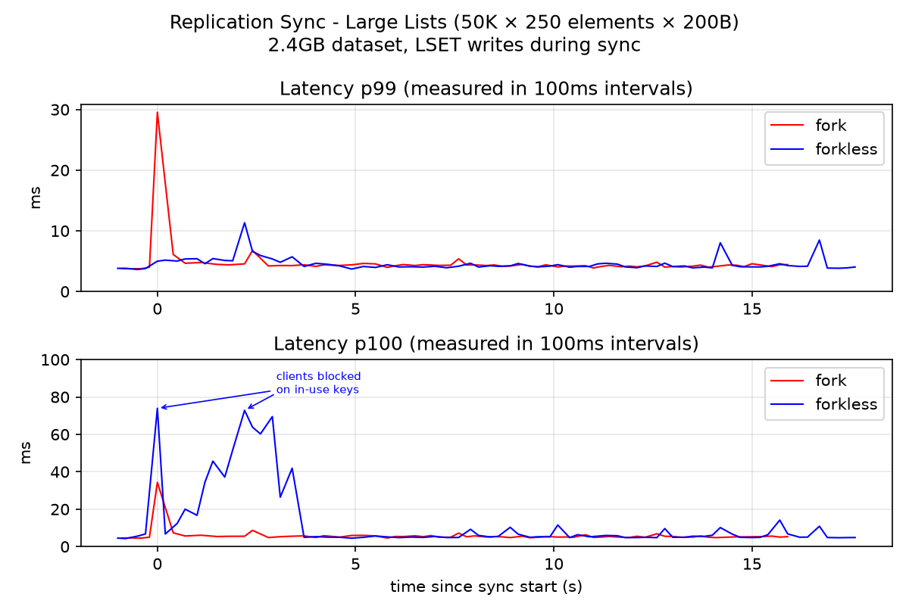
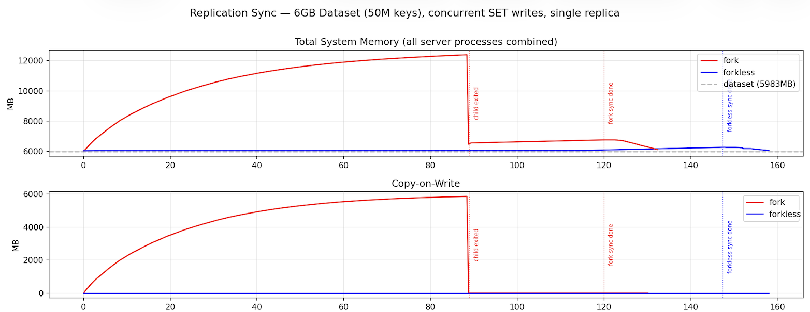
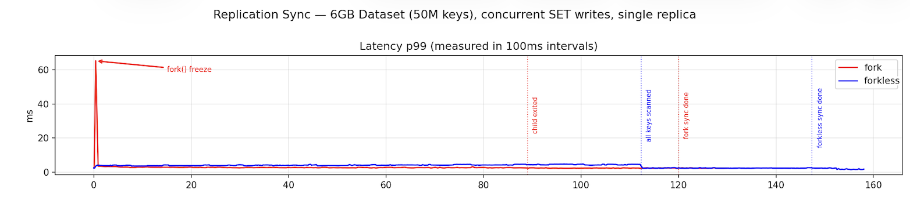

+++
title= "Introducing Fork()-less Save and Full Sync: Save and Sync With Far Less Memory Headroom"
date= 2026-11-20
description= "Valkey 9.2 can take snapshots and sync replicas without calling fork(). Learn how forkless save and full sync avoid copy-on-write memory growth, what they cost, and how to plan for them."
authors= ["nitaicaro"]
[taxonomies]
blog_type = ["Technical Deep Dive"]
[extra]
featured = true
featured_image = "/assets/media/featured/random-03.webp"
+++

Valkey spends most of its life in steady state: answering reads and writes as fast as it can.
But every so often it has to do something heavier and more unusual, such as take a full snapshot of the dataset or hand a complete copy to a new replica.
Because these run alongside live traffic, doing them cheaply — without using too much extra memory, adding latency, or interrupting the clients the server is still serving — is an engineering challenge, as well as an operational one for server administrators, who need to weigh a range of considerations when deciding how these operations run.

Starting in Valkey 9.2, Valkey introduces forkless save and full sync, giving administrators another approach — and more control over the tradeoffs.

Historically, Valkey has performed both save and full sync using the operating system's `fork()` call, which lets the server write out a snapshot, or sync a replica, while continuing to serve clients.
It's a simple and proven approach, but it comes with a possible price: depending on the workload, a save or sync can temporarily increase a server's memory use — and when writes are spread across much of the dataset during the operation, that increase can reach as much as 2x.
The effect is hard to predict, so operators often provision extra memory headroom to stay safe.

Forkless save and full sync take a different approach.
Because no child process is created, there is no copy-on-write memory growth: memory use stays close to the size of the dataset while a save or sync runs, so less headroom needs to be reserved for these operations.
Skipping `fork()` also avoids the brief pause it causes while the kernel copies the process's page tables.

Let's dive into how it works and what it means for you.

## Background: Save and Full Sync with fork()

Since its earliest days, Valkey has used `fork()` for background saves and for full syncs to replicas.
A fork-based operation works as follows:

1. Valkey calls `fork()`, creating a child process that shares the parent's memory.
2. The child writes the dataset, either to an RDB file or directly to the replica's connection.
3. Meanwhile, the parent keeps serving clients.
   During a full sync, it also buffers the writes it receives, to send them to the replica once the snapshot is delivered.
4. When the child finishes, it exits.

The child sees memory exactly as it was at the moment of the fork, so it can produce a consistent snapshot without coordinating with the clients the parent is serving.
The work of serializing the dataset also happens in the child, away from the process that answers clients.

Its main cost is memory.
The parent and child share memory pages until one of them changes a page.
When the parent writes to a shared page, the kernel copies that page, and both copies stay in memory until the child exits.
What drives this growth is how many different pages are written while the child runs, not how many writes there are.
Heavy writes to a few keys copy only a few pages, while writes spread across much of the dataset can copy most of it, up to twice the memory.
Since this depends on the workload during the operation, it is hard to predict, and operators often reserve memory for the worst case.

`fork()` also pauses the server briefly while the kernel copies the process's page tables, a pause that grows with the size of the dataset.
In the 6GB test below, this pause was about 65 ms, and in our experience, pauses of up to a second have been observed on larger dataset sizes.

## The Core Idea: Saving in Place

Instead of copying the process, a forkless operation reads the dataset in place.
The dataset is walked key by key, and the keys are handed to a background thread that writes them out, while the main thread keeps serving clients.
Since nothing is duplicated, memory use stays close to the size of the dataset for the whole operation.

Sharing the data, rather than copying it, brings a challenge that `fork()` avoided.
A forked child has its own frozen view of memory, so writes from clients never reach it.
A forkless operation works on the live dataset, which keeps changing while it is being written out.
Valkey therefore has to coordinate client writes with the background thread, for two reasons: so the result stays consistent even though keys change during the operation, and so a key is never modified while it is in the middle of being written out.

The two operations handle client writes differently:

- **Forkless save** produces a point-in-time snapshot, just like a fork-based save.
  If a client writes to a key that hasn't been saved yet, Valkey saves that key first, so the file reflects the dataset as it was when the save started.
- **Forkless full sync** sends the replica the current data, and sends the writes made during the sync along with it.
  When the sync completes, the replica has the same data as the primary.

In both cases, a write can briefly wait for the background thread to finish writing out the key it touches.
We'll look at what this means for clients below.

## What This Means for Clients

Read commands are never blocked, and most writes aren't either, since a write only waits when it touches a key that the background thread needs to write out at that moment.

How long a write waits depends on the size of the key.
String values of up to 512 bytes don't cause a wait at all, because Valkey copies them instead.
Larger keys, such as large strings or collections like hashes, lists, sets, or sorted sets with many elements, take longer to write out, so a write to one of them can wait longer.
Workloads with very large keys that receive frequent writes see the most impact, and splitting such keys into smaller ones reduces both the chance of a wait and its length.

Command latency can also be higher while a forkless operation runs, compared to a fork-based one, since the work of writing out the dataset now happens inside the server process.

The graph below shows a deliberately unfavorable case for forkless: a full sync of a dataset made entirely of large lists that were never split into smaller keys, with writes to those lists during the sync.
In this test, writes that landed on a list while it was being written out waited up to about 75 ms, as the p100 spikes show.
Even in this case, though, waits were rare: the spikes don't reach p99, so fewer than 1% of writes waited.



## How to Use Forkless Save and Full Sync

### Enabling Forkless Operations

Forkless operations are off by default.
Enabling them takes two settings:

```text
forkless-infrastructure-enabled yes
forkless-policy prefer-forkless
```

- `forkless-infrastructure-enabled` can only be set at startup.
  As its name suggests, it only provides the infrastructure forkless operations need in order to work, and on its own doesn't change how saves or syncs run.
  Enabling it adds 4 bytes to each key.
- `forkless-policy` can be changed at runtime with `CONFIG SET`.
  Its default, `require-fork`, keeps using `fork()`.

Replicas don't need any forkless configuration of their own.

Even with these settings, Valkey can still fall back to `fork()` in some situations, as described in [When Valkey Falls Back to fork()](#when-valkey-falls-back-to-fork).

### When Valkey Falls Back to fork()

`prefer-forkless` isn't a guarantee: when a forkless operation isn't possible, for example when a loaded module doesn't support it or the replica runs a Valkey version older than 9.2, Valkey falls back to `fork()`.
If you rely on forkless, for example when sizing memory, review the [full list of fallback cases](/topics/forkless/#when-valkey-uses-fork-instead) closely, and keep in mind that operations other than saves and full syncs, such as AOF rewrite, still use `fork()`.
Work is ongoing to make forkless available in more configurations, which would allow a setting that never falls back to `fork()`.

### Monitoring Forkless Operations

With `fork()`, the main thing to watch during a save or full sync is copy-on-write memory growth (`current_cow_size`), which doesn't apply to a forkless operation.
What's worth watching instead is write latency, especially on large keys, since writes can wait while a forkless operation runs, as described in [What This Means for Clients](#what-this-means-for-clients).
`forkless_estimated_seconds_remaining` shows roughly how long a forkless operation has left.

To confirm that an operation ran forkless as configured, `rdb_current_bgsave_type` and `rdb_last_bgsave_type` in `INFO persistence` show the method used.
If a fallback did happen, the server log records its reason, and [When Valkey Falls Back to fork()](#when-valkey-falls-back-to-fork) points to how to avoid it.

## Fork vs. Forkless: Head-to-Head Results

To show the difference in practice, we ran the same full sync with each method, on a workload chosen to show the copy-on-write cost clearly: writes spread across most of the dataset while the sync runs, so that nearly every memory page is touched.
These tests ran on a development build of forkless save and full sync before the 9.2 release, so the exact numbers may differ from 9.2, while the patterns they show still apply.

### Memory



With `fork()`, memory almost doubled, nearly all of it copy-on-write.
With forkless sync, memory stayed close to the size of the dataset for the whole operation.

### Latency and Sync Time

While the dataset was being sent, p99 write latency was about 50% higher with forkless sync, and the forkless sync took longer to complete.
The fork-based sync, on the other hand, started with a pause while `fork()` ran, which forkless sync avoided.



## Get Started

Forkless save and full sync give operators a new option for running these operations, with memory use that stays close to the size of the dataset instead of growing with the write pattern.
Whether it's the right choice depends on the workload, and the [forkless documentation](/topics/forkless/) covers the details needed to decide and to plan for it.

To try it, [download Valkey 9.2](/download/).
A big thank you to everyone in the community who contributed to the design, implementation, and review of forkless operations.
