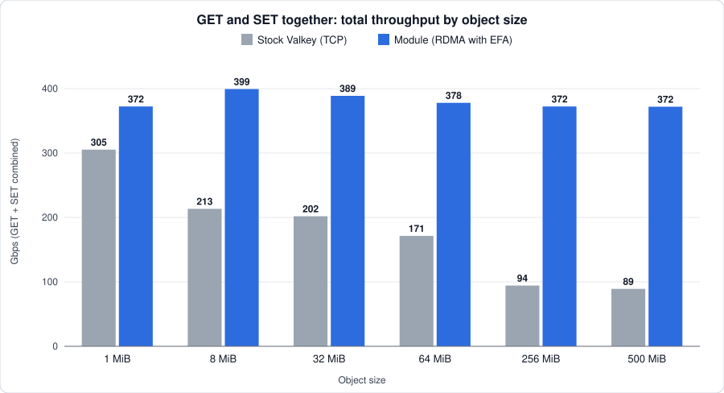

+++
title = "Valkey Large Object Module: As Fast as Your Hardware"
date = 2026-11-24 01:01:01
description = "The Valkey Large Object module keeps values of tens to hundreds of megabytes off the main thread and out of the heap, so a node's throughput follows its network and storage bandwidth, not Valkey's CPU."
authors = ["karthiksubbarao"]

[taxonomies]
blog_type = ["Technical Deep Dive"]

[extra]
featured = false
featured_image = "/assets/media/featured/random-03.webp"
+++

## Where this fits

A large language model reads the whole prompt before it answers.
For every token, at every layer, it computes a key vector and a value vector that later tokens use to decide what to pay attention to.
Those saved vectors are the KV cache.
If a later request starts with the same text, such as a shared system prompt, a long document or the earlier turns of a conversation, the inference engine can load the saved KV cache instead of computing it again, which saves GPU time and shortens the time to the first token.

GPU memory is too small to keep every cache, so inference stacks keep them in tiers: GPU memory, then the host's memory, then a shared store that every GPU server can read, managed by tools such as [LMCache](https://github.com/LMCache/LMCache).
Valkey can be that shared store, and a Valkey cluster scales its capacity independently of the GPU servers, as [KV caching on Valkey](https://valkey.io/blog/kv-caching-on-valkey/) shows for a fleet of GPU servers.

What the shared store has to hold is large.
LMCache splits a prompt into chunks, 256 tokens by default, and stores each chunk as one object.
The size depends on the model and the chunk size:

| Model | Cache per token | 256-token chunk | 2,048-token chunk |
| --- | --- | --- | --- |
| Kimi K2.7-Code (FP8) | 34.3 KiB | 8.6 MiB | 69 MiB |
| Qwen3-235B-A22B (FP8) | 94 KiB | 23.5 MiB | 188 MiB |
| Mistral-Medium-3.5-128B (FP8) | 176 KiB | 44 MiB | 352 MiB |

Larger chunks mean fewer, bigger objects per prompt, and a cache hit has to move many of them quickly.
The Valkey Large Object module is built for that.
However, it is not limited to only KV caching: it optimally stores any large binary value.

## What changes when values reach hundreds of megabytes

Valkey is built for small values, typically a few hundred bytes.
Out of the box a string value is capped at 512 MiB (`proto-max-bulk-len`), a command's own work, such as storing a value, runs on the main thread while other clients wait, and every byte goes through the TCP stack and the server's network buffers.

We measured stock Valkey 9.2 over TCP [TODO: validate these numbers on 9.2.0. we used the numbers from a commit slightly past 9.2 on unstable], with every value held in DRAM, on one i8ge.48xlarge (`maxmemory 640gb`, `allkeys-lru`, 8 I/O threads).

Two c8gn.16xlarge clients drove it with [cachecannon](https://github.com/cachecannon/cachecannon) and a 10-second request timeout.
They used the same number of `GET` and `SET` connections per client as the module runs below: 16 each at 1 and 8 MiB, 12 at 32 MiB, 8 at 64 MiB, and 4 at 256 and 500 MiB.

The workload:

- `GET`s read a 64 GiB hot set that was filled beforehand, so almost every `GET` finds its key.
- `SET`s always write new keys, picked from a billion-key space, so none overwrites an existing value. Once memory is full, every `SET` evicts an older key.
- `GET`s and `SET`s ran together, long enough for memory to fill.
- A separate connection sent a `PING` every 10 ms to show how long an unrelated small command waits.

| Object size | Total Gbps (GET + SET) | GET p50 / p99 | SET p50 / p99 | PING p99 / max | Evictions per second |
| --- | --- | --- | --- | --- | --- |
| 1 MiB | 290.8 (149.5 + 141.3) | 1.1 / 2.6 ms | 1.5 / 4.6 ms | 2.1 / 240 ms | 15,400 |
| 8 MiB | 225.6 (157.2 + 68.4) | 13 / 20 ms | 30-32 / 49-50 ms | 9.6 / 226 ms | 840 |
| 32 MiB | 217.6 (148.7 + 68.9) | 41-43 / 73 ms | 77-78 / 230-238 ms | 15 / 46 ms | 210 |
| 64 MiB | 181.0 (116.0 + 65.0) | 71-74 / 106-114 ms | 115 / 323-325 ms | 17 / 234 ms | 100 |
| 256 MiB | 107.6 (53.0 + 54.6) | 325-333 / 440-453 ms | 331 / 392-394 ms | 26 / 221 ms | 20 |
| 500 MiB | 104.8 (49.5 + 55.2) | 625-654 ms / 1.3-1.4 s | 633-638 ms / 0.7-1.2 s | 34 / 93 ms | 10 |

- **Network:** run alone, `GET`s reached the hosts' TCP ceiling of about 208 Gbps up to 32 MiB, so the network is not what limits stock Valkey here.
- **Other clients:** a `PING` from another connection took 2.1-34 ms at p99 and up to 240 ms, against 0.05 ms when idle.

## What the module is

The [Valkey Large Object module](https://github.com/valkey-io/valkey-large-object) is a Valkey module written in Rust that adds a data type and commands optimized for large binary values.
It needs Valkey 8.0 or later on Linux (x86_64 or aarch64).

Here is the path of one `GET` or `SET` through the module:

![Request path through the module. A client sends a command to the Valkey main thread, which blocks only that client and hands the transfer to a streaming task. The streaming task moves the object as a window of chunks in parallel, for both SET and GET. Chunks move between two kinds of segment pools, DRAM cache segments (four shown) and disk staging segments (two shown), which have their own segment counts. Each segment has its own talc allocator and is registered with both EFA and io_uring. Bytes cross the network by RDMA directly between those segments and the client's EFA-registered memory. Each segment pool has its own io_uring engine to the object files on XFS: the DRAM cache engine reads objects into the cache, and the staging engine reads and writes them.](request_path.svg)

**Data type.** A Large Object data type holds a small descriptor, not the object's bytes: an object ID, the length and a CRC32C checksum.
The bytes live in the module's segments or in a file, depending on the operating mode.
An object can be up to `largeobj.max-object-size` (512 MiB by default, configurable), and in `Dram` mode it must fit in one segment.
Like a String, this is a single value data type.

**Engine.** Every `GET` and `SET` blocks only the client that issues the command, in every storage and transport mode.
The module moves the data on its own worker threads (8 by default, `largeobj.worker-threads`) while the Valkey main thread keeps serving everyone else.
Objects are streamed in chunks (1 MiB by default, `largeobj.chunk-size`), up to 64 at a time (`largeobj.max-buffers-per-op`), and each chunk moves on as soon as its source has produced it, so network and disk transfers overlap.
In `Tiered` mode the chunks pass through a bounded window of reused staging buffers, so a transfer never allocates the whole object.

**Memory.** Data sent or received over EFA must sit in memory registered with the EFA network card, and registering is too slow to do on every transfer.
So the module allocates memory from Valkey in large segments (1 GiB each by default, `largeobj.segment-size`), which count toward `used_memory` and `maxmemory`, and registers each segment when it is created.
In `Tiered` mode the segments are registered with io_uring as well, for performance, so the kernel pins their pages once instead of on every disk read and write, and one buffer serves the network and the disk without a copy.
Inside each segment, the module's own allocator hands out exact-sized, 4 KiB-aligned slots.
The DRAM cache pool starts with one segment and adds more as it fills, up to `maxmemory`.
In `Dram` mode it holds every object, and in `Tiered` mode it acts as a read cache, next to the fixed-size disk staging segment pool described below.

**Disk.** In `Tiered` mode every object is a file on block storage, such as local NVMe or EBS, and DRAM is a read cache:

- The module expects an XFS file system and Linux 5.1 or later. Files sit in `largeobj.disk-dir`, spread over 1,024 subdirectories by object ID so creates and deletes don't serialize on one directory lock.
- Each segment pool has its own io_uring engine, which runs on its own thread. The engines read and write files with `O_DIRECT`, using registered buffers whenever a segment is io_uring registered. Writes and cache misses pass through the fixed-size disk staging segment pool, which totals `largeobj.disk-staging-size` of DRAM registered with the network card, so an object reaches the network without a copy. Staging buffers and the DRAM cache live in separate segment pools, so short-lived staging buffers don't leave holes between long-lived cached objects.
- An object is copied into the DRAM cache on its first read by default (`largeobj.promote-min-hits`). When the cache is full, a cached copy with a low least-frequently-used score is dropped, and the object stays on disk.
- When the disk limit (`largeobj.disk-maxmemory`) or `maxmemory` is reached, a write evicts the least recently used large objects that `maxmemory-policy` allows, as core Valkey does.

**Transport.** The RDMA commands use [libfabric](https://ofiwg.github.io/libfabric/).
A client sends `BLOB.RDMA_HELLO` once per connection with its libfabric endpoint address, and the reply lists the server's addresses.
Each `BLOB.RDMA_GET` or `BLOB.RDMA_SET` then lists one or more remote addresses in the client's registered memory, each with its memory key and length, in one registered region or several, and the server writes to or reads from them directly.
The object bytes never travel on the Valkey TCP connection, which carries only the command and the transfer details.
The server starts every transfer, so a client never gets access to server memory.
`BLOB.TCP_SET` and `BLOB.TCP_GET` carry the bytes on the normal connection and work with any client.
The default `EfaDirect` provider needs EFA hardware.

**Integrity.** `BLOB.RDMA_SET` can send a CRC32C checksum that the server verifies, and `BLOB.RDMA_GET` returns the stored checksum and the length so the client can verify what it received.

## How fast it runs

All numbers here are for the RDMA path over AWS Elastic Fabric Adapter (EFA), in `Tiered` mode.
We have not measured the module over TCP.

The throughput here is limited by the test instances' network card bandwidth and by their storage limits, the local NVMe rating or the EBS bandwidth.
The instance type is an example: on machines with higher bandwidth limits, performance can be well beyond these numbers. [TODO: Consider adding example]

One i8ge.48xlarge server ran the module with a 108 TB disk limit on 16 instance-store NVMe drives striped under XFS.
Two c8gn.16xlarge clients drove it with [cachecannon](https://github.com/cachecannon/cachecannon) over EFA, with the same per-client `GET` and `SET` connections as the stock run above, `GET`s over a 64 GiB hot set and `SET`s of new keys at the same time.
The run first filled the disk to its limit and then ran for 2 hours at the limit, where every `SET` evicts the oldest objects to make room.
The stock Valkey results below are taken from the [earlier section](#what-changes-when-values-reach-hundreds-of-megabytes).



| Object size | Stock Valkey total (Gbps) | Module total (Gbps) | Module / stock | GET p99, stock / module | SET p99, stock / module | PING p99, stock / module | Evictions per second, stock / module |
| --- | --- | --- | --- | --- | --- | --- | --- |
| 1 MiB | 290.8 | 372.2 | 1.3x | 2.6 ms / 2.10 ms | 4.6 ms / 2.75 ms | 2.1 ms / 0.23 ms | 15,400 / 16,700 |
| 8 MiB | 225.6 | 399.3 | 1.8x | 20 ms / 15.2 ms | 49-50 ms / 16.2 ms | 9.6 ms / 0.23 ms | 840 / 2,670 |
| 32 MiB | 217.6 | 388.7 | 1.8x | 73 ms / 37.5 ms | 230-238 ms / 41.2 ms | 15 ms / 0.36 ms | 210 / 680 |
| 64 MiB | 181.0 | 377.9 | 2.1x | 106-114 ms / 54.5 ms | 323-325 ms / 56.1 ms | 17 ms / 0.35 ms | 100 / 340 |
| 256 MiB | 107.6 | 372.3 | 3.5x | 440-453 ms / 101 ms | 392-394 ms / 105 ms | 26 ms / 0.33 ms | 20 / 82 |
| 500 MiB | 104.8 | 371.9 | 3.5x | 1.3-1.4 s / 193 ms | 0.7-1.2 s / 195 ms | 34 ms / 0.32 ms | 10 / 43 |

- With reads and writes together, the module moved 1.8x to 3.5x the throughput of stock Valkey from 8 MiB up, and 1.3x at 1 MiB. Its total stayed between 372 and 399 Gbps at every size, while stock Valkey's fell from 291 Gbps at 1 MiB to 105 Gbps at 500 MiB.
- A `PING` from a separate client waited at most 0.36 ms at p99 with the module, against 2.1-34 ms with stock Valkey.
- At the limit every `SET` evicts an older object. From 8 MiB up the module evicted 3 to 4 times faster than stock Valkey, because it accepted that many more `SET`s, and it rejected none at any size.
- On the same instance type, the module node held 108 TB on NVMe, about 150 times the 640 GiB that stock Valkey held in DRAM.
- With the DRAM cache turned off, so that every `GET` reads from NVMe, `GET`s reached the same 215-216 Gbps as cache hits from DRAM. On this instance the 16 local NVMe drives deliver more read bandwidth than the network can carry, so the cache doesn't change throughput. It matters when storage is the limit, for example on EBS, where reads and writes share one bandwidth limit: every `GET` served from DRAM leaves that bandwidth to `SET`s.

## Try it

The [getting started guide](https://valkey.io/topics/large-object-getting-started/) covers the requirements, building the module from source and your first commands.
[Configuration and monitoring](https://valkey.io/topics/large-object-configuration/) lists every setting, and [use cases](https://valkey.io/topics/large-object-use-cases/) shows where the module fits.

The benchmark above ran with this command, on an i8ge.48xlarge with its 16 NVMe drives striped under XFS:

```bash
valkey-server \
  --port 6379 --save '' --appendonly no \
  --maxmemory-policy allkeys-lru \
  --loadmodule ./target/release/libvalkey_large_object.so \
  --largeobj.operating-mode Tiered \
  --largeobj.disk-dir /mnt/bigobj-data/lo \
  --largeobj.segment-size 1073741824 \
  --largeobj.disk-staging-size 17179869184 \
  --largeobj.disk-maxmemory 108000000000000 \
  --largeobj.fabric-provider EfaDirect
```

The TCP commands work with any client.
The RDMA commands need a client that implements the libfabric flow; Valkey GLIDE's Python sync client supports them from `valkey-glide-sync` 2.6.0.
The module is open source, and release 0.1 is available at [valkey-io/valkey-large-object](https://github.com/valkey-io/valkey-large-object).
